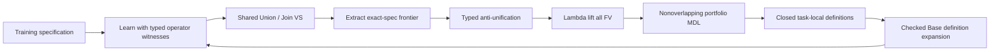
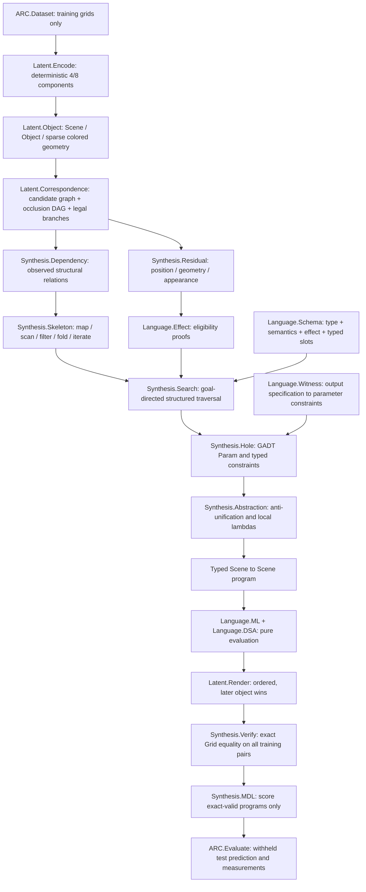
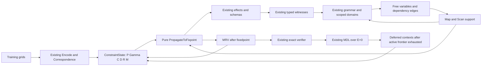
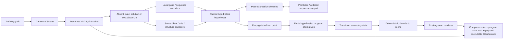
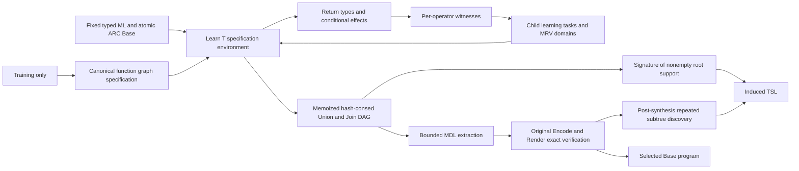

# LATIS v0.3R.1 extension

`solve-v03r1` uses independent `Synthesis.InducedR1` modules and the unchanged
`Language.Induced.Base`. The original v0.3R command/modules remain available.

The first pass bootstraps nonempty Base support; later passes use supported
Base symbols plus accepted definitions. Each engine owns its dictionary, memo,
and support set. No dictionary is transferred between ARC tasks. A related
subproblem sequence is explicitly one engine/task and is used to measure
feedback; the baseline activates the same supported Base and keeps memoization.

`FunctionOrder` expresses stable key inequalities without inventing ranks.
Conditional fold transition traces, zipWith element graphs, multiplicity-aware
filter, range bounds, lazy if branch rows and lexical let child specifications
extend partial deduction. Boundaries are explicit: finite observation domains,
first-order AU, no captured-binder holes, bounded invocation arguments, rounds,
dictionary count, AST size and parameter count. Definition expansion invokes
the same Base evaluator; no invention-specific primitive or inverse is installed.

MDL includes definition, reference and explicit argument lengths and chooses a
nonoverlapping AST cover. Work counters separate prefix search, subsequent
search, and discovery logical units. They do not measure every evaluation step
or predict wall time. In the dedicated 40-demand fixture, subsequent search and
combined logical work decrease, while Full wall time remains higher.

`Expressible(Base)` and bounded `Reachable(Base,Spec,Witness,TSL)` are distinct.
Unsuccessful canonical correspondence is not a Base impossibility proof.
`ProvenBaseMissing` is reserved for a real certificate and is never emitted by
this implementation. Isolated test-only constructive programs certify two
remaining regressions without supplying any reference AST to the solver.

Reproduction and all seven modes are in `scripts/run_v03r1.py`; the provenance
validator/report builder is `scripts/make_v03r1_report.py`. Results and remaining
coverage limitations are in [reports/LATIS_V03R1_REPORT.md](reports/v03/LATIS_V03R1_REPORT.md).

# LATIS v0.1 architecture

The encoder and renderer preserve `Render(Encode(g)) = g`. Transformations need not be invertible. Matching reconstructs input-derived geometry hidden behind later objects; no probabilistic inverse renderer is used.

The language has no recursive AST constructor. `iterateWhile` receives nonnegative fuel and propagates evaluation failures. Unsupported correspondence or search fragments remain diagnostics, rather than global impossibility claims.

The Direct benchmark shares representation and verification, but traverses complete object programs without correspondence, residual, dependency, or witness information. All timings include analysis work and cache input encoding once.
# v0.2A joint constraint controller

新入口为 `Synthesis.Joint.jointSearch`；原 `Synthesis.Search.search` 保留。

`Constraint.State` 保存 guarded skeleton domains 与 GADT holes；`Constraint.Propagate` 负责 type/value/effect/dependency/structural 规则和 provenance；`Expression.FreeVars/Domain` 读取原 typed `Param` grammar；`Search.Memo` 实现表达式、规范 partial state 和 program caches；`Joint` 负责 fixedpoint/MRV/deferred frontier 与预算；`ARC.JointEvaluate` 生成新结果/压力任务/消融。没有新算子、observer 或 latent segmentation。

传播不随机挑候选；branch 在固定点后执行。context 展开先尝试 current，失败才试 admissible larger scopes；穷尽模式会把已访问 assignments 视为 nogoods，再搜索 deferred scope，同时保留已找到程序。所有 constraint 带 rule、correspondence branch、pair、object 与 premises；candidate 依赖边带 guard，不能混为最终依赖。只有严格相同 seed/step AST 且无 Previous 的 scan 全局等价 map，训练等价候选仍保留。

终止条件、memo keys、穷尽范围、状态事件定义与消融负结果见 `reports/v02a/LATIS_V02A_REPORT.md`。前面的 v0.1 架构文档保留。
# v0.3 hierarchical extension

Canonical Object Grounding Principle: existing `Latent.{Grid,Object,Encode,Render,Correspondence}` and all v0.2A synthesis semantics remain unchanged. New modules compose with, rather than overwrite, the joint solver.

`Latent.Local.{Grammar,Encode,Decode,Discover}` contains reversible typed RelativePose/Pairwise/Progression/SharedClass structures, preserving class geometry/color, orientation, provenance and paint permutation. `Latent.Global.*` contains finite scene observation lenses over an explicit canonical residual. Bounding-box-center axes and verified pixel symmetry axes are distinct constructors.

`Latent.Fusion.Context` represents H=(A,D,Z,C,L), plus the canonical/local/global environment. `Latent.Program` contains GADT coordinate/vector expressions, `transformFusion : ZF -> ZF`, and a separately evaluated grounded expression AST. `Latent.Constraint.Propagate` extends Sigma by composition with an active hypothesis domain, propagating symbol typing, hole-value witnesses and skeleton support to a data fixed point before branching. `Latent.MDL.LatentCost` charges codec/program AST lengths, full dependency symbols and constant exceptions. `Latent.Serialize` emits readable typed JSON for both structure and provenance.

The discovery schedule is task-local and single-pass: run Z0, inspect regularity if triggered, synthesize/restrict high-level candidates, decode, exact-verify, compare MDL. It does not interleave secondary discoveries into every node of the old DFS. Iterative cross-latent propagation is FutureWork. Arbitrary constructor composition, neural features and Level-0 ontology hypothesis search are outside this version.

`ARC.LatentStress`, `ARC.HierarchicalEvaluate`, `ARC.FailureTaxonomy` implement independent fixture equations, post-selection heldout checks and bounded-fragment diagnostic certificates. `scripts/run_v03.py` verifies the immutable uniform 30-task sample, runs development validations, seals source/binary/protocol before opening the audit and refuses source changes on resumption. `scripts/make_v03_report.py` validates source preservation and measured regression equivalence before generating the report.

# v0.3R independent language induction

The only grounding imports in `Language.Induced.Base` are canonical Grid/Object/Render. The learner imports canonical Encode/Render/Correspondence, not legacy program grammars or controllers. `ARC.InducedEvaluate` serializes the typed AST, parameter access paths, VS graph and per-symbol support. The experiment runner invokes the legacy executable command in separate processes; none of those results feeds new synthesis.

`Expr` is abstract and created through checked primitive/application constructors. Kernel typing is polymorphic; synthesis monomorphization is finite. All assembled candidates are checked again before exact verification. Function specifications are finite `(environment,input,output)` graphs; lambda binds the input to a fresh typed variable. map decomposes an aligned list graph; generic scan decomposes seed plus pair-parameter step graphs and includes its seed in the result. Translate deduces vectors from corresponding TL differences; coordDelta learns both coordinate children from Base observations. A step reads tuple projections derived from free variables/access paths, without a prelisted previous-object dependency family.

No complete Scene AST is stored before final extraction in the full solver. Observer subexpressions are materialized to condition witnesses. The VSA is a bounded underapproximation: partial witnesses, at most 64 decompositions per operator, finite passive observer domains, terminal observation policy, recursion depth and ranked extraction frontier all constrain coverage. Alternative child domains remain correlated inside their Join. The no-sharing mode removes learning memoization/hash-consing and eagerly constructs child products; the no-witness mode performs actual typed bottom-up expansion under lambda contexts and at the root.

New effects only restrict the finite conditional input domain used by a witness, not arbitrary nested Base expressions. Turning effects off still requires valid witness children. FV propagation coalesces rows only when projected bindings have a single required label; conflicting labels cannot be merged. MRV estimates the surviving immediate forward/witness domain, rather than pretending to know an unbuilt recursive VS cardinality. Work units count learning visits, rules, witness lookahead and specification comparisons; forward observer evaluation, matching and serialization are also reflected in process/wall timing, not claimed to be fully counted by those discrete units.

Inventions are discovered after exact verification and named anonymously. Repeated alpha-equivalent lambda terms are a restricted form of anti-unification. Portfolio MDL charges a definition of L+2 and each reference of 2 units. The selected raw Base program keeps its own AST/MDL; naming a one-use lambda does not lower that score. Rich hierarchical secondary codecs remain solely in the explicitly labeled legacy path; the new learner currently uses secondary observations represented as Base expressions, with no claim of preserving all v0.3 discovery coverage.

`scripts/run_v03r.py` verifies immutable task and legacy source hashes, fingerprints new source/binary/protocol, executes sequentially, records timeouts, and caches only matching fingerprints. It never resumes/overwrites the sealed first v0.3 audit. `scripts/make_v03r_report.py` uses the resulting JSON to produce Q1–Q10 and all seven ablations. Tests cover the generic kernel, grounding adapter/cells, witness constraints, VS exact soundness/provenance and a size/position perturbation of the core learned program.

## Independent v0.3R.2 path

`Synthesis.InducedR2` uses the unchanged `Language.Induced.Base` kernel and the R.1 specification/AU machinery. Structural signatures distinguish dependency paths, literals, observers, effects and typed structure. Alpha-renaming and a whitelist of universal Base identities normalize syntax; observational equality alone does not normalize it. Contexts are interned with an exact dictionary, without hash-collision equivalence assumptions.

`Sharing` introduces scope-safe Base lets only when they reduce actual shared code length. It preserves strictness of partial expressions in lazy branches. `PortfolioCover` materializes complete witnesses and single-hole substitutions through existing VSA edges before internal Cartesian products can exhaust the work budget. `AliasSharing` changes a shared initializer using its recorded observational class; proposals require kernel typing and original training verification. This is generic congruence through a binding, not an operator family.

`VersionSpace` separately performs incremental cost saturation: representatives become available at their effective MDL/prior cost, correlated products are remembered, and unexpanded alternatives remain in the DAG. The covering traversal is not a claim of complete Cartesian extraction. The solver retains the R.1 deductive recursion safety bound and finite witness domains; cost bounds refine the expression portfolio without increasing the legacy depth/frontier. A global budget bounds the loop; extraction/discovery batch costs and wall time are reported independently.

Online feedback adds definition-expanded alternatives to actual learned function demands, checks every recorded context of a shared node, and rebuilds parent edges while preserving the old VSA. Inventions have no dedicated witnesses and remain task-local. Exact root representatives are added as annotated certificate leaves alongside the symbolic DAG.

Internal denotations are Base values under the recorded specification context. Final root certificates use the canonical encoded target of the verified rendered Grid as their observation: equality of pixels does not claim equality of hidden Scene object identities or list order. These final certificate classes are exported after feedback and do not supply initializer substitutions during search.

`Counterfactual` receives candidate programs and training inputs after selection. It searches a finite input-only perturbation domain and records differing predictions; none of these predictions supplies synthesis labels. Heldout labels are used solely by the later export audit. The `NoCounterfactualDiagnosis` ablation must select the same program and portfolio as Full.
