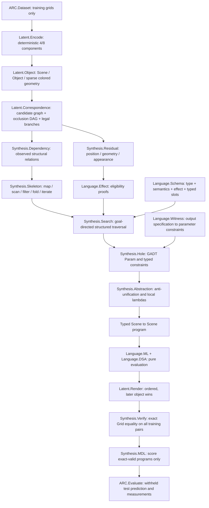

# LATIS v0.1 architecture

The encoder and renderer preserve `Render(Encode(g)) = g`. Transformations need not be invertible. Matching reconstructs input-derived geometry hidden behind later objects; no probabilistic inverse renderer is used.

The language has no recursive AST constructor. `iterateWhile` receives nonnegative fuel and propagates evaluation failures. Unsupported correspondence or search fragments remain diagnostics, rather than global impossibility claims.

The Direct benchmark shares representation and verification, but traverses complete object programs without correspondence, residual, dependency, or witness information. All timings include analysis work and cache input encoding once.
