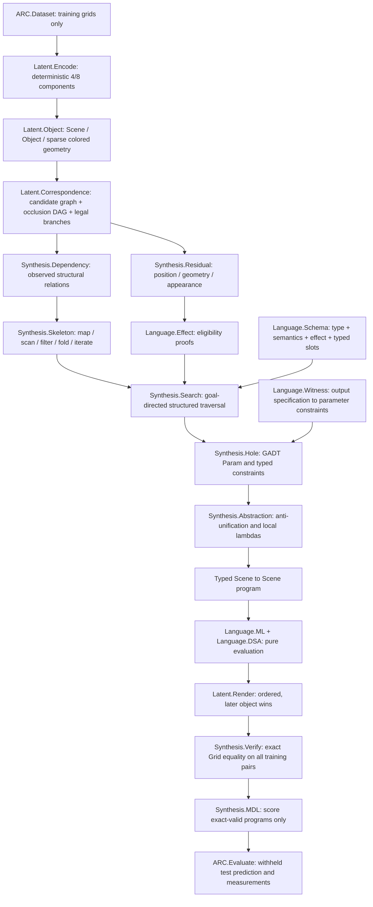
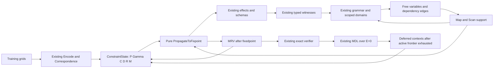

# LATIS v0.1 architecture

The encoder and renderer preserve `Render(Encode(g)) = g`. Transformations need not be invertible. Matching reconstructs input-derived geometry hidden behind later objects; no probabilistic inverse renderer is used.

The language has no recursive AST constructor. `iterateWhile` receives nonnegative fuel and propagates evaluation failures. Unsupported correspondence or search fragments remain diagnostics, rather than global impossibility claims.

The Direct benchmark shares representation and verification, but traverses complete object programs without correspondence, residual, dependency, or witness information. All timings include analysis work and cache input encoding once.
# v0.2A joint constraint controller

新入口为 `Synthesis.Joint.jointSearch`；原 `Synthesis.Search.search` 保留。

`Constraint.State` 保存 guarded skeleton domains 与 GADT holes；`Constraint.Propagate` 负责 type/value/effect/dependency/structural 规则和 provenance；`Expression.FreeVars/Domain` 读取原 typed `Param` grammar；`Search.Memo` 实现表达式、规范 partial state 和 program caches；`Joint` 负责 fixedpoint/MRV/deferred frontier 与预算；`ARC.JointEvaluate` 生成新结果/压力任务/消融。没有新算子、observer 或 latent segmentation。

传播不随机挑候选；branch 在固定点后执行。context 展开先尝试 current，失败才试 admissible larger scopes；穷尽模式会把已访问 assignments 视为 nogoods，再搜索 deferred scope，同时保留已找到程序。所有 constraint 带 rule、correspondence branch、pair、object 与 premises；candidate 依赖边带 guard，不能混为最终依赖。只有严格相同 seed/step AST 且无 Previous 的 scan 全局等价 map，训练等价候选仍保留。

终止条件、memo keys、穷尽范围、状态事件定义与消融负结果见 `LATIS_V02A_REPORT.md`。前面的 v0.1 架构文档保留。
