# LATIS — Latent Task-Induced Synthesis

新增 **v0.4 — Triggered Typed Feature Saturation**：`solve-v04` 优先使用逐对象 Object/Position 特征、触发式可见性、冻结剪枝、全局共享解释与 output-wise construction；失败自动回退原 R2。运行方法与边界见 [设计说明](docs/LATIS_V04.md)，实测与消融见 [v0.4 报告](LATIS_V04_REPORT.md)。`--workers N`（配合 `+RTS -N<N>`）可并行求值单任务 source closure 的候选表达式，结果与串行逐位一致；语义、预算与性能实测见设计说明的并行章节和 [并行报告](LATIS_V04_PARALLEL_REPORT.md)。

新增实验入口 **`solve-features`**：同特征匹配／同类型程序、跨特征匹配／程序复用、全输出 witness 驱动的剩余特征构造。统一限制为标量常量和跨案例语义指称。实现范围、预算及运行方法见 [三阶段算法说明](docs/FEATURE_PIPELINE.md)；旧版本入口保留用于对照。

最新入口是 **v0.3R.1**：固定 typed Base，扩充 generic deductive witnesses，并让 typed anti-unification / lambda lifting 产生的 task-local inventions 回馈后续 Learn。StructuralPriorCount=0；v0.3R 和 legacy 路径保留。结果与限制见 [LATIS_V03R1_REPORT.md](LATIS_V03R1_REPORT.md)，前一轮见 [LATIS_V03R_REPORT.md](LATIS_V03R_REPORT.md)。

```powershell
cabal --config-file=scripts/cabal.config run latis --offline -- solve-v03r1 --task data/03560426.json --out results/v03r1/single --mode Full
```

新增 **v0.3 — Hierarchical Latent Discovery**：固定 canonical object ontology 上的 symbolic local/global/fusion coordinate discovery。原 v0.2A source 与入口保留；高阶表示具有可逆 decoder、typed pose expressions、provenance、完整 codec MDL 与 exact Grid verification。

```powershell
./scripts/run-v03.ps1
cabal --config-file=scripts/cabal.config run latis --offline -- solve-v03 --task data/03560426.json --out results/v03/core
cabal --config-file=scripts/cabal.config run latis --offline -- solve-v02a --task data/03560426.json --out results/v02a/run
```

`v03-stress` 跑 A–J；`v03-regression` 比较旧 v0.2A / LatentDisabled / Full；`v03-ablation` 跑八组 v0.3 mode 并保留真实 v0.2A。`--mode` 支持 `V03Full|NoLocalLatent|NoGlobalLatent|NoFusion|NoLatentMDL|EagerLatentEnumeration|NoProgramToLatent|LatentDisabled`。开发套件用 `python scripts/run_v03.py --no-audit`。每个任务输出 `solution.json`、`hypotheses.json`、`task.json`、`latent_trace.md`。

30-task 官方 ARC-1 training 随机抽样在核心实现前固定于 `results/v03/frozen_arc1_tasks.json`；`scripts/freeze_arc1.py` 验证已有文件时不会重新选题。首次 audit 的 source/binary/预算/开启时间另行封存于 `audit_opened.json`；之后源或 protocol 改变会拒绝覆盖首次 audit。详细研究结论、MDL 比较范围、消融与保守 failure taxonomy 见 [LATIS_V03_REPORT.md](LATIS_V03_REPORT.md)。没有加入 split/union/occlusion search、neural 或新的 Level-0 object semantics。

v0.3 先尝试真实旧 solver；高成本或失败后才发现 abstraction。新坐标程序同时可展开为独立可执行的 Z0 reference AST，比完整 `A→P→D` 与 legacy 两者的最小成本。该 reference 不代表原 v0.2A 搜索出了程序，也没有 unrestricted CSE/let 优化；报告明确区分 legacy 成本与展开参考成本。`LatentDisabled` 完全复现原 solver。

当前新增 **v0.2A — Constraint-Driven Joint Synthesis**：在同一 constraint state 中传播 effect、typed schema、witness、参数表达式、自由变量与 Map/Scan 支持，达到 fixed point 后才分支。v0.1 的所有语义模块、参数语法、原 11 项任务与完整搜索入口均保留。

```powershell
./scripts/run-v02a.ps1
```

该脚本离线构建、运行两套测试、七组 core 消融、11 项回归、6 项压力任务及其七组消融，生成 [LATIS_V02A_REPORT.md](LATIS_V02A_REPORT.md)。结果包括 [完整 core trace](results/03560426/v02a_trace.md)、[消融表](results/03560426/v02a_ablation.md)、[压力任务消融](results/v02a/stress/ablation.md)、原始 JSON 与环境/source 哈希。`03560426` 保持原 scan，最终 expanded 314、首解 266；原 Full 为 1305、1251。全部训练/heldout 回归通过，具体统计口径、时间与负结果见报告。

单独运行：

```powershell
cabal --config-file=scripts/cabal.config run latis --offline -- joint-solve --task data/03560426.json --out results/03560426
cabal --config-file=scripts/cabal.config run latis --offline -- joint-benchmark --out results/03560426 --repeats 5
cabal --config-file=scripts/cabal.config run latis --offline -- joint-suite --out results/v02a/synthetic
cabal --config-file=scripts/cabal.config run latis --offline -- joint-stress --out results/v02a/stress
```

Joint modes：`JointConstraint`、`NoBidirectionalSkeleton`、`NoWitnessFirst`、`NoLazyContext`、`NoStructuralDominance`、`NoMemoization`。可选 `--budget`、`--branches`、`--solutions`；默认 joint 用 100,000 solution limit 以覆盖穷尽测试。scope 中使用的 source 仍只有旧 DSL 可观察的 current/prev/grid；首解后延后的 scope 不被删掉，trace 会记录先前 frontier 已遍历的证明。只有同 AST 且无 prev 的 scan→map 全局 rewrite 可以 hard prune。没有扩充 DSL、神经网络、SMT 或新增外部包。

## 保留的 v0.1 使用说明

面向 ARC-AGI-1 的纯符号 Haskell 实验：从 object-centric latent IO 推导程序结构，再合成类型化参数。没有神经网络、学习式分割、跨任务库学习或无界递归。附带官方 `03560426` 样例、可运行基线、五组消融与实测报告。

## 快速运行

需要 GHC >= 9.6、Cabal >= 3.0；依赖仅使用 GHC 随附的库，不需要安装 Torch、Python 包或 Hackage 包。本机用 GHC 9.14.1 验证。

```powershell
cabal --config-file=scripts/cabal.config build all --offline
cabal --config-file=scripts/cabal.config test --offline --test-show-details=direct
cabal --config-file=scripts/cabal.config run latis --offline -- solve --task data/03560426.json --out results/03560426
cabal --config-file=scripts/cabal.config run latis --offline -- benchmark --task data/03560426.json --out results/03560426 --repeats 5
cabal --config-file=scripts/cabal.config run latis --offline -- suite --out results/synthetic
python scripts/make_report.py
```

或执行 `./scripts/run.ps1 -Repeats 5` 一次完成构建、测试、消融和合成任务验证。`scripts/cabal.config` 将 Cabal 缓存、日志和 store 保存在项目内，故没有配置远程包源；离线构建时该提示不影响运行。

读取更多 ARC JSON：

```powershell
cabal --config-file=scripts/cabal.config run latis --offline -- evaluate --data path/to/ARC/data/training --out results/dataset --limit 20
```

`solve` 输出 `solution.json`（含测试输入的预测）、`trace.md` 与 `primitives.md`。测试 JSON 可以没有 `output`，合成只接收 `train`。

可选配置：`--mode Full|NoEffect|NoDependency|NoWitness|Direct`、`--connectivity 4|8`、`--budget 1000000`、`--branches 256`、`--radius 2`、`--solutions 128`。预算在有限批次之间检查，匹配与依赖分析批次可能超过小预算；报告会标记停止原因。没有无界枚举。

## Pipeline 与架构

独立的模块依赖图见 [ARCHITECTURE.md](ARCHITECTURE.md)。

```mermaid
flowchart LR
  G[Training Grid pairs] --> E[Deterministic Encode]
  E --> Z[Scene: canvas + background + ordered objects]
  Z --> C[Symbolic correspondence branches + occlusion DAG]
  C --> R[Residual latent fields]
  R --> D[Dependency evidence: map / scan / filter / fold / iterate]
  D --> S[Skeleton candidates]
  S --> F[Effect-compatible primitive schemas]
  F --> H[Typed parameter holes]
  H --> W[Witness specifications + anti-unification]
  W --> P[Unified symbolic parameter expressions]
  P --> V[Render and exact training-grid verification]
  V --> M[MDL over exact-valid programs]
  M --> T[Task-local concepts and TSL closure]
  M --> O[Test-grid prediction]
```



`f = Render . h . Encode`，真正合成的是 `h : Scene -> Scene`。编码提取背景以外的**极大同色连通分量**（所有分量，非只取最大一个）。局部稀疏彩色几何、位置、包围盒、颜色、尺寸与 orientation 都保留；ID 只用于 provenance/correspondence，从不进入参数表达式。`Center` 使用向 TL 取整的整数格点中心。

渲染按物体 list 顺序执行，后物体覆盖先物体。局部 bbox 的空洞不涂背景；越界放置返回错误，不静默裁剪。round-trip 覆盖所有可编码的矩形 ARC 色值网格。

`03560426` 的输出物体因遮挡缺角。匹配器对输入的完整几何做有限旋转／反射与颜色候选匹配，要求缺失像素只能由其他非背景物体覆盖，建立遮挡 DAG，并对整个 branch 渲染验证。相同色／形状／尺寸／相对次序用于排序候选；有歧义时保留 branch，超过预算明确标为 `CurrentlyUnsupported`。

## 结构化搜索

`Full` 从 IO 的坐标关系与可见属性触发 skeleton，不枚举任意 AST。关系语法覆盖 TL/TR/BL/BR/Center、当前／上一输出物体及画布角点；没有特殊的任务 ID、颜色、矩阵或 BR/TL 规则分支。

`Translate` 的 schema 将当前物体绑定，只留下 `vec : Vec`；witness 直接产生 `TL(target)-TL(source)`。这些实例通过 typed anti-unification 变为一个参数洞，再搜索能满足**全部实例**的坐标表达式。witness 路径不枚举 Vec 数值；只有所有规格相同，才直接引入一个已推导的常量。

效应判定分为 `ProvenImpossible`、`CurrentlyUnsupported`、`Eligible`。只有前者可以 hard prune；某算子不具备必需写入字段时，才对这个单步目标证明不可能。额外的 effect 不自动构成不可能，因为对称几何可保持不变。失败的 bounded search 不表示整个 ARC task 不可解。

所有候选最终都要通过 `Render(h(Encode(x))) == y`。`J = L + K + 2E` 仅用于已经 exact-valid 的程序；K 计入去重后的 primitive 与 task-local concept 名称，以及所有传递依赖。`Start`／`Attach` 不隐藏 Translate 或角点 observers。L 是文档定义的 AST 描述单位，不是文件字节数。

## 语言、模块与搜索范围

| 层 | 模块 | 内容 |
|---|---|---|
| Representation | `Latent/{Grid,Object,Encode,Render}` | 纯数据类型、4/8 连通分量、later-wins 渲染 |
| Matching | `Latent/Correspondence` | 候选图、遮挡顺序、歧义 branch |
| Language | `Language/{Types,ML,DSA,Effect,Schema,Witness}` | GADT 类型、固定高阶 combinators、ARC observers/relations/operators、schema 与 witness |
| Synthesis | `Synthesis/{Residual,Dependency,Skeleton,Hole,Search,Verify,MDL,Abstraction}` | 结构证据、typed holes、约束合成、验证、评分、本地概念 |
| IO / experiments | `ARC/{Dataset,Evaluate}`, `app/Main.hs` | 严格 ARC JSON reader、CLI、预测、实验记录 |

完整 [primitive/type/effect/schema/witness 表](results/03560426/primitives.md) 由 registry 生成。`Language.ML` 实现 lambda/application/composition、map/filter/sortBy/scan/fold、if、算术、tuple/list、argmin/argmax 与带 fuel 的 iterateWhile。错误通过 `Either` 传播。

当前搜索 body 支持单步 identity/Translate/Rotate90/180/270/ReflectH/V/Recolor；typed interpreter 支持 composition，搜索尚未组合任意多步 transformation。六种对象次序、有限 predicate 参数、简单 bbox 聚合 fold 和观察到 transition chain 的有界平移 iterate 构成 v0.1 的小型搜索空间。iterate 的 fuel 最多 4，step 为八邻域单位向量；只能把重迭解释作为可验证假设，不能从端点 IO 唯一证明真实中间过程。

通用 object union/split、完全不可见物体、彩色物体 learned segmentation、任意 aggregate、任意 loop predicate、画布 resize、任意数值表达式和多步 transformation 搜索均未覆盖；数据结构和 typed combinators 已为扩展保留接口。

## 实验与交付

| 模式 | 变化 |
|---|---|
| A Full | 所有结构机制 |
| B NoEffect | 不做 effect prune，继续用 witness 验证 |
| C NoDependency | 不读取 dependency evidence，遍历有限 skeleton 集合 |
| D NoWitness | 不使用参数 witness，遍历 typed holes 的 Cartesian product |
| E Direct | 不做 output correspondence/residual/dependency/witness 的 bounded object-program 枚举 |

初始目录为空，没有可复用的“既有 baseline”；E 是新增、清楚标明边界的直接 object-program 对照。各模式共用 encoder、operators、坐标表达式语法、输入编码缓存和 exact verifier。D/E 的数值常量限制为 `--radius`，Full 直接使用 witness 推导的统一常量；本次核心解不含数值向量常量，位于共同片段。不能将结果推广为相对任意 ARC 枚举器的结论。

状态计数包含 correspondence edges/branches、dependency relation hypotheses、partial skeletons、effect queries、hole expression checks 与完整候选验证；没有把分析工作当作免费步骤。所有模式都缓存输入编码一次；time 包含分析、验证及最终 MDL，排除文件读取、构建与报告写入。

- [LATIS_V01_REPORT.md](LATIS_V01_REPORT.md)：Q1–Q6、消融解释、边界与瓶颈。
- [完整 synthesis trace](results/03560426/trace.md)：匹配图、所有 witness、选择的程序及 TSL。
- [消融表](results/03560426/ablation.md)、[原始 CSV](results/03560426/ablation.csv)、[原始 JSON](results/03560426/ablation.json)。
- [合成任务结果](results/synthetic/suite.md)：包含其他 anchor、reverse ordering、map、filter、fold、iterate 的留出验证。

测试包括 1,518 次 round-trip、遮挡／稀疏渲染、类型/schema、安全 fuel、非可逆 recolor witness、correspondence 歧义与限制、MDL dependency closure、11 个合成留出样例及官方任务的训练与测试输入。`test/negative/BadHole.hs` 是故意无法编译的负例，可用 `ghc -fno-code -isrc -outputdir build/type-negative test/negative/BadHole.hs` 检查 `Param Vec` 不能装入 Int 表达式。

官方样例的来源、SHA256 与上游许可证见 [data/README.md](data/README.md)。

## LATIS v0.3R — independent Induced-TSL rebaseline

`solve-v03r` 是独立入口。它不调用旧 `Synthesis.Skeleton`、joint solver 或 v0.3 handwritten latent codecs。固定 Base 在 `Language.Induced.Base`；新 TSL 是 **非空 root version space 的 signature，加上合成后发现的 task-local inventions**，而不是 winning program 的 used-symbol closure。

```powershell
cabal --config-file=scripts/cabal.config run latis --offline -- solve-v03r --task data/03560426.json --out results/v03r/03560426
python scripts/run_v03r.py --tests
python scripts/make_v03r_report.py
```

新模式为 `InducedTSLFull`、`NoWitness`、`NoVersionSpaceSharing`、`NoTaskAbstraction`、`NoEffectPropagation`、`NoFVDependency`。实验 runner 另外调用保留的 `solve-v03`，标为 `LegacyFamilies`。默认新 solver bounds 是 250000 work units、depth 7、frontier 32、correspondence 32；diagnostic set 使用 25000 work units。独立进程每题每模式限时 60 秒。

`lambda/application/let/if`、polymorphic tuples/lists/sets/options、map/filter/fold/scan/zipWith/sortBy/argmin/argmax、标量及坐标代数都有 typed constructor 与 forward semantics。PlacedObject 是原 Object × Pose 的 adapter，`cells` 是同一 canonical Scene 的 lossless observation。AnchorType 和 D4 是参数；Base 没有 Attach、ScanP、MapPose 或 progression family。

新搜索是 `Learn(type,spec,env)`：return-type filtering → conditional effects → operator witness → child tasks → MRV → shared Union/Join → bounded ranked extraction → original Grid exact verification。Witness 是 partial；通用 bounded forward observers 条件化 inverse semantics。已有 exact observation 会作为 terminal domain，避免无限 identity 展开。这里得到的是 **bounded discovered support**；未激活的 symbol 不等于数学上不可能支持该 task。

`I<n>` inventions 来自多个 distinct exact-valid portfolio 程序中的 repeated alpha-equivalent lambda subtrees。定义与引用都计成本；saving 明确以 portfolio 为范围，不能冒充单个 scan AST 的节省。所有数据沿用 v0.3 snapshots；原 30 题标为 `PreviouslyOpenedDiagnosticSet`。结果、回归退化、witness/representation coverage 与 Q1–Q10 见 [LATIS_V03R_REPORT.md](LATIS_V03R_REPORT.md)；核心 trace 位于 [results/v03r/03560426/induced_tsl_trace.md](results/v03r/03560426/induced_tsl_trace.md)。

## v0.3R.1：deductive coverage 与在线 task abstraction

固定 Base 不变。新 witness 覆盖 filter/fold/sortBy/argminBy/argmaxBy/zipWith/range/if/let 及更多算术、Coord/Vec inverse domains；这些仍是有界 partial witnesses。排序使用 key inequalities，fold 使用经 Base 求值验证的中间 transition graph。

在线 loop 从 actual exact-spec frontier 做 typed anti-unification，提升 free variables，计算包含定义与显式参数的非重叠 portfolio MDL；正 saving 才安装 task-local definition。后续 Learn 使用普通 checked Base lambda/application 展开，所有 dictionaries 都在一次 task/session 结束时丢弃。没有 Attach/Progression 专用 operator/witness，没有 cross-task library。

```powershell
$env:PATH = 'E:\ghcup\bin;' + $env:PATH
E:\anaconda3\python.exe scripts/run_v03r1.py --tests --timeout 90
E:\anaconda3\python.exe scripts/make_v03r1_report.py

# 新参数、新输出目录；同参数会缓存，--force 可强制重新测时。
E:\anaconda3\python.exe scripts/run_v03r1.py `
  --out results/v03r1-rerun --budget 500000 --diagnostic-budget 50000 `
  --depth 9 --frontier 64 --branches 64 --timeout 180 `
  --rounds 2 --inventions 6 --ast-size 96 --parameters 4 --tests
E:\anaconda3\python.exe scripts/make_v03r1_report.py `
  --out results/v03r1-rerun --report LATIS_V03R1_RERUN_REPORT.md
```

消融 modes：Full / NoOnlineAbstraction / PostHocOnly / NoAntiUnification / NoLambdaLifting / NoNewWitnessCoverage / LegacyFamilies。可用 `--groups`、`--modes` 跑子集；完整报告生成器要求完整矩阵与 tests。原 30 题依然只能称 PreviouslyOpenedDiagnosticSet。

`test/InducedR1Main.hs` 包括参数化 AU、lifting、false abstraction/capture rejection、generic progression、inverse soundness，以及从 Learn prefix 自动发现 Attach-like definition 后处理 40 个相关 demands 的反馈测试。相关 demands 是同一 task 的子问题，不是跨题 transfer。search work 与 wall time 分开记录；降低后续搜索量不等于整个 session 的运行时间加速。

## v0.3R.2：结构多样性、共享与可达性

独立命令 `solve-v03r2` 保持固定 Base。观测等价类保存每种重要结构签名的代表，包括依赖、literal/observer provenance 和 higher-order form。只有全输入成立的 Base 等式会归一化；training 相等本身不触发删除。通用 `let` CSE 按共享代码计成本；替换等价 initializer 时同时改变所有引用，并在原 training Grid 上重新验证。

搜索先覆盖已有 deductive DAG 的完整 witnesses 和 single-hole alternatives，再按成本逐层细化；没有 Full semantic-alias cap 或 AST frontier beam。覆盖遍历不能替代完整 Cartesian saturation。有限 observation/witness domains、原来的 7 层 deductive 安全界和全局工作预算仍限制 reachability。字典反馈保留先前 Base VSA，再以 checked Base definition expansion 添加候选。counterfactual diagnosis 只在固定选择后运行。

```powershell
# 使用已编译的 O2 solver；完整七模式矩阵和 previously-opened diagnostics。
python scripts/check_v03r2_tests.py
python scripts/run_v03r2.py --binary build/latis-r2-final.exe --timeout 300
python scripts/make_v03r2_report.py

# 新实验目录；不覆盖旧版本结果。不会提高 depth/frontier。
python scripts/check_v03r2_tests.py --out results/v03r2-rerun
python scripts/run_v03r2.py --out results/v03r2-rerun `
  --budget 250000 --cost 96 --saturation-budget 25000 --timeout 300
python scripts/make_v03r2_report.py --out results/v03r2-rerun --report LATIS_V03R2_RERUN_REPORT.md `
  --cover-out results/v03r2-rerun-cover-ablation --deadline-out results/v03r2-rerun-deadline-ablation

# 单题：saturation-budget 是每次细化阶段的工作上限，仍受总 budget 约束。
build/latis-r2-final.exe solve-v03r2 --task data/03560426.json `
  --out results/v03r2-single --mode Full --budget 250000 --cost 96 --saturation-budget 25000
```

七项消融为 Full / NoDiversityPreservation / FixedAliasCap / NoLetSharing / NoGroundedLiteralPrior / BeamSearchLegacy / NoCounterfactualDiagnosis；额外 `NoPortfolioCover` 检查完整 witness 覆盖的作用。结果与限制见 `LATIS_V03R2_REPORT.md`。每次运行保存 source/binary/input hashes、完整命令、equivalence classes、共享上下文、VSA、portfolio 和原 training/heldout 验证。

首次构建 runner 默认的二进制：`ghc -O2 -isrc -iapp -XGHC2021 -outputdir build/r2-opt app/Main.hs -o build/latis-r2-final.exe`。测试脚本可用 `--cabal`、`--ghc`、`--ghc-pkg` 指定工具路径；它将 R.1 兼容测试的新结果写入 R2 实验目录，保留旧报告数据。

## Dependent Collection + Explained Alignment 实验

新增 `solve-collection` 与 `collection-experiment`，从携带 size index 的无序集合出发，通过带 provenance 的 OrderBy、RankAlign、AlignmentLift 与匿名抽象实现可变数量对象的解释式对齐。03560426 的新前端训练和留出均 exact；七组消融与负向测试检查枚举顺序、尺寸约束、偶然 equality 和高层具体边泄漏。原 v0.4 与 R2 路径保留。

复现与限制见 [集合实验设计](docs/LATIS_COLLECTION.md)，结果见 [实验报告](LATIS_COLLECTION_REPORT.md)。

```powershell
cabal run latis -- collection-experiment --out results/v05
python scripts/report_collection.py
```

## v0.6：Counterfactual-Preserving Online Abstraction

新增 `solve-collection-v6` 与 `collection-v6-experiment`，作为 v0.5 collection front-end 的增量升级（v0.5 模块与 R2 不改动）。三项机制：训练上 denotation 相同的候选保留为 semantic class 内的多个 representative，并用带合法性证明的 counterfactual context 检测它们是否真的不同；alignment key 不再限死为六个手写键，而是在 AlignmentFailure 触发后由受限 KeyExpr 语法合成；语义内聚的子图在搜索过程中被 anti-unify、按 utility 在线 promotion 并在同一次 solve 中复用。附带 dependent size index 反例与 11 组消融。

复现与限制见 [v0.6 设计](docs/LATIS_V06.md)，结果见 [实验报告](LATIS_V06_REPORT.md)。

```powershell
./scripts/run_collection_v6.ps1
```

## 案例与程序可视化

`python scripts/visualize_latis.py --solution results/v03r2/core/03560426/Full --out docs/03560426.html`

生成可离线打开的 HTML：输入、标准输出、原 Base 内核重放的预测、像素差异、可折叠 typed AST 和 portfolio 统计。用 `--results results/v03r2` 批量展示 Full，`--mode all` 包含消融，`--runghc` 指定 GHC 路径，`--no-predict` 只看保存数据。完整用法见 [可视化说明](docs/LATIS_VISUALIZER.md)。已生成的批量页面为 `docs/latis-explorer.html`。

页面还包含用户程序积木工作台：Base/TSL 工具箱、拖放或点击插槽、常量滑块、lambda/let 作用域、即时类型检查、撤销/重做和 JSON 导入导出。类型完整的 `Scene → Scene` 程序可导出并用上述脚本重放；inventions 导出时展开回 Base。
