# LATIS v0.1 — Latent Task-Induced Synthesis

面向 ARC-AGI-1 的纯符号 Haskell 实验：从 object-centric latent IO 推导程序结构，再合成类型化参数。没有神经网络、学习式分割、跨任务库学习或无界递归。附带官方 `03560426` 样例、可运行基线、五组消融与实测报告。

## 快速运行

需要 GHC >= 9.6、Cabal >= 3.0；依赖仅使用 GHC 随附的库，不需要安装 Torch、Python 包或 Hackage 包。本机用 GHC 9.14.1 验证。

```powershell
cabal --config-file=scripts/cabal.config build all --offline
cabal --config-file=scripts/cabal.config test --offline --test-show-details=direct
cabal --config-file=scripts/cabal.config run latis --offline -- solve --task data/03560426.json --out results/03560426
cabal --config-file=scripts/cabal.config run latis --offline -- benchmark --task data/03560426.json --out results/03560426 --repeats 5
cabal --config-file=scripts/cabal.config run latis --offline -- suite --out results/synthetic
python scripts/make_report.py
```

或执行 `./scripts/run.ps1 -Repeats 5` 一次完成构建、测试、消融和合成任务验证。`scripts/cabal.config` 将 Cabal 缓存、日志和 store 保存在项目内，故没有配置远程包源；离线构建时该提示不影响运行。

读取更多 ARC JSON：

```powershell
cabal --config-file=scripts/cabal.config run latis --offline -- evaluate --data path/to/ARC/data/training --out results/dataset --limit 20
```

`solve` 输出 `solution.json`（含测试输入的预测）、`trace.md` 与 `primitives.md`。测试 JSON 可以没有 `output`，合成只接收 `train`。

可选配置：`--mode Full|NoEffect|NoDependency|NoWitness|Direct`、`--connectivity 4|8`、`--budget 1000000`、`--branches 256`、`--radius 2`、`--solutions 128`。预算在有限批次之间检查，匹配与依赖分析批次可能超过小预算；报告会标记停止原因。没有无界枚举。

## Pipeline 与架构

独立的模块依赖图见 [ARCHITECTURE.md](ARCHITECTURE.md)。

```mermaid
flowchart LR
  G[Training Grid pairs] --> E[Deterministic Encode]
  E --> Z[Scene: canvas + background + ordered objects]
  Z --> C[Symbolic correspondence branches + occlusion DAG]
  C --> R[Residual latent fields]
  R --> D[Dependency evidence: map / scan / filter / fold / iterate]
  D --> S[Skeleton candidates]
  S --> F[Effect-compatible primitive schemas]
  F --> H[Typed parameter holes]
  H --> W[Witness specifications + anti-unification]
  W --> P[Unified symbolic parameter expressions]
  P --> V[Render and exact training-grid verification]
  V --> M[MDL over exact-valid programs]
  M --> T[Task-local concepts and TSL closure]
  M --> O[Test-grid prediction]
```



`f = Render . h . Encode`，真正合成的是 `h : Scene -> Scene`。编码提取背景以外的**极大同色连通分量**（所有分量，非只取最大一个）。局部稀疏彩色几何、位置、包围盒、颜色、尺寸与 orientation 都保留；ID 只用于 provenance/correspondence，从不进入参数表达式。`Center` 使用向 TL 取整的整数格点中心。

渲染按物体 list 顺序执行，后物体覆盖先物体。局部 bbox 的空洞不涂背景；越界放置返回错误，不静默裁剪。round-trip 覆盖所有可编码的矩形 ARC 色值网格。

`03560426` 的输出物体因遮挡缺角。匹配器对输入的完整几何做有限旋转／反射与颜色候选匹配，要求缺失像素只能由其他非背景物体覆盖，建立遮挡 DAG，并对整个 branch 渲染验证。相同色／形状／尺寸／相对次序用于排序候选；有歧义时保留 branch，超过预算明确标为 `CurrentlyUnsupported`。

## 结构化搜索

`Full` 从 IO 的坐标关系与可见属性触发 skeleton，不枚举任意 AST。关系语法覆盖 TL/TR/BL/BR/Center、当前／上一输出物体及画布角点；没有特殊的任务 ID、颜色、矩阵或 BR/TL 规则分支。

`Translate` 的 schema 将当前物体绑定，只留下 `vec : Vec`；witness 直接产生 `TL(target)-TL(source)`。这些实例通过 typed anti-unification 变为一个参数洞，再搜索能满足**全部实例**的坐标表达式。witness 路径不枚举 Vec 数值；只有所有规格相同，才直接引入一个已推导的常量。

效应判定分为 `ProvenImpossible`、`CurrentlyUnsupported`、`Eligible`。只有前者可以 hard prune；某算子不具备必需写入字段时，才对这个单步目标证明不可能。额外的 effect 不自动构成不可能，因为对称几何可保持不变。失败的 bounded search 不表示整个 ARC task 不可解。

所有候选最终都要通过 `Render(h(Encode(x))) == y`。`J = L + K + 2E` 仅用于已经 exact-valid 的程序；K 计入去重后的 primitive 与 task-local concept 名称，以及所有传递依赖。`Start`／`Attach` 不隐藏 Translate 或角点 observers。L 是文档定义的 AST 描述单位，不是文件字节数。

## 语言、模块与搜索范围

| 层 | 模块 | 内容 |
|---|---|---|
| Representation | `Latent/{Grid,Object,Encode,Render}` | 纯数据类型、4/8 连通分量、later-wins 渲染 |
| Matching | `Latent/Correspondence` | 候选图、遮挡顺序、歧义 branch |
| Language | `Language/{Types,ML,DSA,Effect,Schema,Witness}` | GADT 类型、固定高阶 combinators、ARC observers/relations/operators、schema 与 witness |
| Synthesis | `Synthesis/{Residual,Dependency,Skeleton,Hole,Search,Verify,MDL,Abstraction}` | 结构证据、typed holes、约束合成、验证、评分、本地概念 |
| IO / experiments | `ARC/{Dataset,Evaluate}`, `app/Main.hs` | 严格 ARC JSON reader、CLI、预测、实验记录 |

完整 [primitive/type/effect/schema/witness 表](results/03560426/primitives.md) 由 registry 生成。`Language.ML` 实现 lambda/application/composition、map/filter/sortBy/scan/fold、if、算术、tuple/list、argmin/argmax 与带 fuel 的 iterateWhile。错误通过 `Either` 传播。

当前搜索 body 支持单步 identity/Translate/Rotate90/180/270/ReflectH/V/Recolor；typed interpreter 支持 composition，搜索尚未组合任意多步 transformation。六种对象次序、有限 predicate 参数、简单 bbox 聚合 fold 和观察到 transition chain 的有界平移 iterate 构成 v0.1 的小型搜索空间。iterate 的 fuel 最多 4，step 为八邻域单位向量；只能把重迭解释作为可验证假设，不能从端点 IO 唯一证明真实中间过程。

通用 object union/split、完全不可见物体、彩色物体 learned segmentation、任意 aggregate、任意 loop predicate、画布 resize、任意数值表达式和多步 transformation 搜索均未覆盖；数据结构和 typed combinators 已为扩展保留接口。

## 实验与交付

| 模式 | 变化 |
|---|---|
| A Full | 所有结构机制 |
| B NoEffect | 不做 effect prune，继续用 witness 验证 |
| C NoDependency | 不读取 dependency evidence，遍历有限 skeleton 集合 |
| D NoWitness | 不使用参数 witness，遍历 typed holes 的 Cartesian product |
| E Direct | 不做 output correspondence/residual/dependency/witness 的 bounded object-program 枚举 |

初始目录为空，没有可复用的“既有 baseline”；E 是新增、清楚标明边界的直接 object-program 对照。各模式共用 encoder、operators、坐标表达式语法、输入编码缓存和 exact verifier。D/E 的数值常量限制为 `--radius`，Full 直接使用 witness 推导的统一常量；本次核心解不含数值向量常量，位于共同片段。不能将结果推广为相对任意 ARC 枚举器的结论。

状态计数包含 correspondence edges/branches、dependency relation hypotheses、partial skeletons、effect queries、hole expression checks 与完整候选验证；没有把分析工作当作免费步骤。所有模式都缓存输入编码一次；time 包含分析、验证及最终 MDL，排除文件读取、构建与报告写入。

- [LATIS_V01_REPORT.md](LATIS_V01_REPORT.md)：Q1–Q6、消融解释、边界与瓶颈。
- [完整 synthesis trace](results/03560426/trace.md)：匹配图、所有 witness、选择的程序及 TSL。
- [消融表](results/03560426/ablation.md)、[原始 CSV](results/03560426/ablation.csv)、[原始 JSON](results/03560426/ablation.json)。
- [合成任务结果](results/synthetic/suite.md)：包含其他 anchor、reverse ordering、map、filter、fold、iterate 的留出验证。

测试包括 1,518 次 round-trip、遮挡／稀疏渲染、类型/schema、安全 fuel、非可逆 recolor witness、correspondence 歧义与限制、MDL dependency closure、11 个合成留出样例及官方任务的训练与测试输入。`test/negative/BadHole.hs` 是故意无法编译的负例，可用 `ghc -fno-code -isrc -outputdir build/type-negative test/negative/BadHole.hs` 检查 `Param Vec` 不能装入 Int 表达式。

官方样例的来源、SHA256 与上游许可证见 [data/README.md](data/README.md)。
