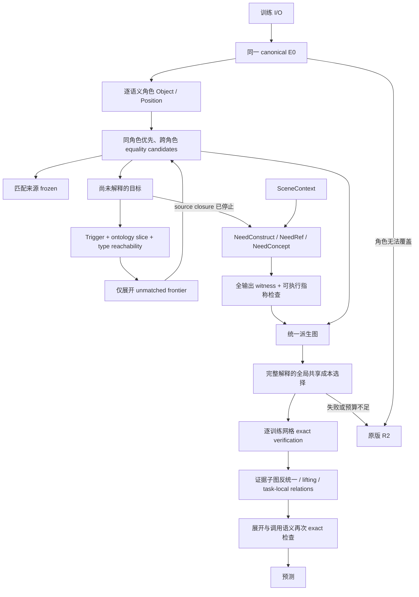

# LATIS v0.4 — Triggered Typed Feature Saturation

本版新增 `solve-v04`，优先运行 declarative feature front-end；失败时，以原配置和原训练集调用 `Synthesis.InducedR2.Learn.inducedSearch Full`。R2 源码与旧入口未修改。此前的 `solve-features` 实验入口也保留，但不承担 v0.4 的实现。

## 运行

```powershell
cabal --config-file=scripts/cabal.config run latis --offline -- solve-v04 --task data/03560426.json --out results/v04/03560426 --mode Full
cabal --config-file=scripts/cabal.config run latis --offline -- v04-stress --out results/v04/stress
cabal --config-file=scripts/cabal.config run latis --offline -- v04-r2-stress --out results/v04/r2-baseline
cabal --config-file=scripts/cabal.config run latis --offline -- v04-stress --out results/v04/stress-workers4 --workers 4 +RTS -N4 -RTS
cabal --config-file=scripts/cabal.config run latis --offline -- solve-v04 --task data/03560426.json --out results/v04/03560426-workers4 --mode Full --workers 4 +RTS -N4 -RTS
cabal --config-file=scripts/cabal.config run latis --offline -- v04-bench --out results/v04/bench --workers 1 --repeats 9 --warmup 2 +RTS -N1 -T -RTS   # 再以 --workers 2 +RTS -N2、--workers 4 +RTS -N4 各运行一次
cabal --config-file=scripts/cabal.config test triggered-tests latis-tests feature-pipeline-tests induced-r2-tests --offline --test-show-details=direct
cabal --config-file=scripts/cabal.config test triggered-parallel-tests --offline --test-show-details=direct --test-options="+RTS -N4 -RTS"
python scripts/report_v04.py
```

前端默认 source budget=12000、construction budget=12000、selection budget=100000、depth=4。CLI 对应 `--feature-budget`、`--construction-budget`、`--selection-budget`、`--feature-depth`。`--budget` 是独立的 R2 work budget，默认 250000；前端工作不从它扣除。API 支持零预算与完整 R2 配置。

## 数据流



## 表示、匹配与触发

每个角色有两个初始特征：ObjectT 是局部稀疏几何及颜色，位置归零；CoordT 是位置。特征保存跨案例 vector、symbolic term、role、history、cost、status、depth。根节点记录 grounding ID 仅作诊断；执行表达式没有 ID observer。输出目标以独立 target 节点序列化。

角色语法支持唯一物体、唯一指定颜色物体、全体或指定颜色中的水平／垂直极值。并列不按扫描次序消歧。当前跨案例角色覆盖要求固定的一组可定义角色，覆盖所有对象；可变对象数量不在这个原型的前端覆盖范围内。

`rematch` 使用 `(Type, denotation vector)` 查找所有 equality 候选。同角色候选排在前面，但不会提交为唯一解释。所有已匹配来源立即冻结，下一次普通展开前再次检查状态。AnchorOffset 可以以 active Position 为主参数，将同角色的 frozen Object 作为显式 `NeedRef` 的只读参数。

算子注册表按 `(ontology slice, input type)` 建索引；Full 只查询当前需求解锁的 slice。可见 operator type graph 再做 reachability 检查。注册表存在不代表算子会被枚举执行。原型固定 slice 包括 Geometry、Palette、Displacement、AnchorRelation、ConceptSlice；200 个压力噪声算子放在未触发的 ConceptSlice。

每条生成 hyperedge 保存 trigger、parent goal、type reason、ontology slice、provenance；额外依赖与固定标量参数也分别保存 evidence。`NeedExplain`、`NeedTransform`、`NeedRef`、`NeedConcept`、`NeedConstruct`、`NeedRelation` 用于生成／构造；`RefinementTrigger` 与 `FailureTrigger` 用于受限 refinement/widening 接口。消融放宽也使用显式 FailureTrigger，不制造匿名无依据展开。

## 原型算子范围

使用与既有 canonical 语义相同的 D4、recolor、四个单位坐标步进及四个局部锚点偏移。它们是小型 typed wrapper registry，并非把完整 R2 Base/TSL 无条件搬进前向闭包。没有任务 ID 分支，也没有 Attach、At、Chain 结构模板。

多参数 AnchorOffset 只连接同角色的初始 Object；没有任意参数 Cartesian product。定义按名称共享，每次应用仍须在全部案例上执行。NoTransformReuse 对每次应用重新收取定义构建费用，并在解释成本中不共享定义。

Semantic state 合并同类型、同 vector 的表达式；所有不同结构代表保留，没有 alias≤2 上限。结构索引避免重复插入完全相同的表达式。不同路径仍可能产生很多别名，因此保留深度、source 与 selection 三类独立限制。

## SceneContext 与 output-wise witness

SceneContext 不在初始 feature 集合、source frontier 或 operator index 中。source closure 因无增长、深度限制或预算停止后，才为未解释目标解锁 construction。Decoder 若需要改变画布布局，也在 source closure 之后触发 SceneT construction；相同布局直接沿用 canonical decoder 的输入布局契约。

每个目标 witness 同时保留所有案例的 input context、output context 与 required value。新表达式必须在可用 input context／已解析输出依赖上重放，满足全部目标 vector。GridBR 等引用在运行时按已确定的输出尺寸求值，绝不读取预测目标网格。输出依赖使用 `Output target` 表示；全局选择之后重新求值，检测循环和缺失依赖。

引用搜索优先于构造。引用包括画布锚点、语义选中对象及其锚点。构造概念复用 `FeaturePipeline.outputWitness` 的全输出矩形语法：单色实心矩形，大小为共享常量或画布维度，锚点对齐。具体坐标与对象表不会作为 invented relation 的捕获值保存。泛型稀疏形状生成、遮挡推理、递归对象数量和任意算术 reference 尚未覆盖。

## 全局解释和关系

有限派生图中的所有完整候选通过 branch-and-bound 比较，成本包含 unique definition、call、reference，以及构造常量的 groundedness penalty。选择依据只使用训练案例；heldout 仅用于选择后的审计。选择预算不足时不声称最优，也不返回一个未经完整选择的前端解，而是 fallback。

`optimal_within_generated_graph` 指关系压缩前、已生成 feature candidates 上的共享成本最优，不是无限 DSL 中的全局最优。关系抽取从成功匹配的派生子图进行 typed structural anti-unification：保留共同调用拓扑，将不同 root/ref 提升成 typed parameters，并保留重复参数的依赖一致性。

接受评分记录 compression gain、search-reduction estimate、decoupling gain、coverage。后两者使没有立即 AST 压缩收益、但有重复可复用结构的候选也可被接受。`search_reduction` 明确是结构估计，不能解释成已测得后续搜索加速。

接受的匿名 I_k 注册为 task-local operator；最终程序实际调用它们，并再次 exact 验证。较大关系可引用较小关系，level 自动为依赖最大 level+1。refinement 只能返回记录的依赖边，未经 FailureTrigger 的 widening 被拒绝。

本轮关系发现位于完整解释之后，未实现“中途发现新关系并重新调度未完成 saturation”的在线反馈。因此 NoRelationInvention/FlatRelations 当前主要验证执行表示、参数隔离及层级约束，不能用它们声称搜索量改进。关系的类型／refinement 接口已可用于下一轮调度扩展。

## 消融定义

| Mode | 行为 |
|---|---|
| Full | 需求可见性、冻结剪枝、定义共享、lifting、context、关系 |
| NoMatchedFeaturePruning | 允许冻结节点继续普通展开 |
| NoVisibility | 保留类型相关性，但显式解锁所有注册 slice |
| NoIntensionalLifting | 关闭 context reference 与 concept lifting |
| NoTransformReuse | 重复收取定义工作与定义成本 |
| NoSceneContext | 禁止 context construction/reference |
| NoRelationInvention | 不生成匿名关系，执行原始 feature terms |
| FlatRelations | 关系展开为直接 Base 依赖，level=0 |
| DirectBaseExpansion | 全 slice、无冻结剪枝、无关系发现 |
| R2FallbackOnly | 跳过前端，直接调用原版 R2 |

`v04-stress` 隔离前端机制；其中 R2FallbackOnly 为禁用前端的零工作对照，不能当作 R2 性能。`v04-r2-stress` 另外真实执行 A–G 的 R2FallbackOnly，并保存独立 work 和预测。H 由 `solve-v04` 验证真实 fallback。

## Metrics 与预算

source budget 包含逐案例 operator evaluation 以及首次定义构建的符号费用；NoTransformReuse 每次收取。construction budget 包含 reference／concept 全案例检查及矩形 witness 工作。selection budget 限制 branch-and-bound 节点。所有完整向量检查均预留预算，避免半个案例向量被错误接受。

最终 `search_work = source_search_work + construction_work + selection_work`。这是可复现的逻辑工作计数，不等于 CPU 指令、秒数或 R2 的 expanded-work 单位。role grounding、匹配索引维护、图序列化与最终 exact verification 不计入该逻辑预算；耗时另外记录。`visibility_size` 为累计候选数，ratio 的分母是累计 type-compatible opportunities。

两个硬性零值由图审计计算：无 evidence 的展开、以及非参数化的 relation capture 都会使对应计数增加。负向单元测试验证 exposure 审计并非硬编码零。完整 artifacts 包括 `solution.json`、`derivation_graph.json`、触发后才填充的 `contexts.json`、`trace.txt` 和可选 `r2-fallback/`。

## 兼容性界限

前端失败不会缩减 R2 的预算、语言或配置。一个前端训练 exact 的假设仍可能在未知案例上泛化失败；本原型不声称对所有 ARC heldout 都不劣于 R2，也没有用测试标签选择是否 fallback。实测范围及负结果见根目录 `LATIS_V04_REPORT.md`。

## 并行候选求值（`--workers`）

本节描述 `solve-v04` 单任务内部 source closure 的候选表达式并行求值。并行化只覆盖 `sourceClosure` 中“对一个候选 term 在全部训练案例上求值”这一步；场景构造、全局解释选择、关系发现和 R2 fallback 全部保持串行且未修改。算子语法、抽象指称规则、output-wise witness、目标选择与 fallback 条件均未改变。

### 结构

实现位于 `Synthesis.Triggered.Parallel`。纯函数 `Synthesis.Triggered.sourceClosure` 原样保留，是行为基准和测试参考；`--workers 1`（默认）直接走这条纯串行路径，不创建任何线程。

`workers ≥ 2` 时：

- 唯一的调度线程负责候选顺序、trigger、可见性、预算、定义共享、特征插入、去重、匹配、冻结、派生边与指标，全部以**提交时的权威图**为准；
- worker 线程只执行 `evalTerm`：输入是候选 term，输出是完整跨案例结果 `Either String [Value]`，在 worker 内 `forceCases` 完全求值后才交回，不留惰性 thunk；
- worker 不持有 Graph、定义集合、feature ID、缓存或预算计数；
- worker 池有界（`workers` 个线程），待处理队列有界（STM `TBQueue`，容量 = `window`），不会为全部候选一次性创建线程。

### 快照、推测与状态失效

每个深度开始时，调度器基于只读快照生成本深度的候选计划（frontier × 可见算子，顺序与串行算法完全相同），并把最多 `window` 个候选提前提交给 worker。快照不授权任何图更新：调度器仍按串行顺序逐个候选重新计算预算守卫、来源冻结状态、只读参数与 term；只有当权威 term 与推测 term 完全一致时，推测结果才被使用。因为结果只是 term 的纯函数（定义集合、训练输入与 layout 在 closure 内不变），一个推测结果要么被原样采用，要么被丢弃，不存在“部分正确”。

- 已失效候选（来源被前面的提交冻结、目标已被解释、预算不足、深度结束）的推测结果直接丢弃，不插入图、不计入逻辑工作；
- 线程完成顺序不影响候选顺序、feature ID、匹配、选中解释或 fallback：调度器只等待它当前需要的那个结果；
- 新深度解锁的候选由权威图重新规划，不依赖旧快照；
- 不为凑满批次提前开放 SceneContext 或绕过触发规则：计划只包含串行算法本身会枚举的候选。

当前只做深度内的小窗口推测，不跨深度预取。

### 预算与推测上限

`sourceBudget` 的逻辑计费语义不变：每次应用收取 `案例数 + 首次定义构建费用`，定义首次使用按提交顺序判定、只计一次；`NoTransformReuse` 仍对每次应用重复收费。预算守卫在提交前按权威状态检查，推测结果从不导致超额提交（测试覆盖 budget=0、1 和不足一次跨案例求值的情形）。

推测带来的额外实际计算由 `--speculation-cap C` 限制：只有当 `已丢弃推测数 + 在途推测数 < C` 时才提交新的推测，因此 `parallel_discarded ≤ C` 无条件成立。上限耗尽后，候选改为在调度线程内联求值，搜索结果与串行完全一致。`C=0` 完全关闭推测。

| 参数 | 默认 | 含义 |
|---|---|---|
| `--workers N` | 1 | worker 线程数（正整数）；1 = 纯串行参考实现 |
| `--window W` | 4·N | 已提交但尚未消费／丢弃的推测候选上限，也是待处理队列容量 |
| `--speculation-cap C` | 256 | 每个任务允许丢弃的推测求值上限（非负整数） |

`v04-stress --workers N` 表示每个单任务内部的 worker 数，矩阵本身仍逐任务、逐模式串行。

### 指标

逻辑指标含义不变：`operator_applications` 是按串行顺序**提交**的应用次数，`search_work` 是提交的逻辑费用；两者与 workers 无关。新增逻辑计数 `evaluation_failures`（串行与并行路径都统计求值返回 `Left` 的应用，这些应用照常计费、不生成特征）。

物理执行指标以 `parallel_` 为前缀，只在 `workers ≥ 2` 时出现，并记录在 `solution.json` 的 `metrics` 中：

| 指标 | 含义 |
|---|---|
| `parallel_planned` / `parallel_submitted` | 快照规划的候选数 / 实际提交给 worker 的推测数 |
| `parallel_consumed` | 被提交结果采用的推测数 |
| `parallel_inline_evaluations` | 调度线程内联求值数（无推测可用或上限耗尽） |
| `parallel_discarded` (+ `_invalid` / `_depth_end` / `_stale`) | 丢弃的推测数及原因 |
| `parallel_discarded_evaluated` / `parallel_discarded_cancelled` | 丢弃时 worker 已完成求值 / 尚未开始而被取消 |
| `parallel_actual_evaluations` | 实际发生的跨案例求值 = consumed + inline + discarded_evaluated |
| `parallel_cap_refusals` / `parallel_max_inflight` | 因上限拒绝提交的次数 / 在途推测峰值 |

恒等式 `parallel_consumed + parallel_inline_evaluations = operator_applications` 使额外计算可审计：相对串行的额外实际求值正是 `parallel_discarded_evaluated`。`parallel_discarded_evaluated/_cancelled` 取决于线程时序，是唯一非确定的计数；其余 `parallel_*` 计数由计划决定，可复现。`closure_wall_clock` 单独记录 source closure 阶段耗时；`solution.json` 的 `parallel` 对象记录 workers/window/cap。

### 异常

worker 内的同步异常通过请求结果传回调度线程并原样重新抛出（即使该推测随后被丢弃也不吞掉），`bracket` 负责终止全部 worker；不会死锁。

### 线程运行时

可执行文件与新测试套件以 `-threaded -rtsopts` 构建。`--workers N` 只创建 N 个 Haskell 线程；OS 级并行度由 RTS capability 数决定，必须另外用 `+RTS -N<k>` 指定。只加 `-N` 而不加 `--workers` 不会并行化搜索；只加 `--workers` 而不加 `-N` 时 worker 只在一个 OS 线程上交错执行（程序会打印警告）。Linux 示例：

```bash
cabal build exe:latis
cabal run latis -- solve-v04 --task data/03560426.json --out results/v04-parallel/03560426 --workers 4 +RTS -N4 -RTS
cabal run latis -- v04-stress --out results/v04-parallel/stress-w4 --workers 4 +RTS -N4 -RTS
cabal run latis -- v04-bench --out results/v04-parallel/bench --workers 4 --repeats 7 --warmup 2 +RTS -N4 -T -RTS
cabal test triggered-parallel-tests --test-show-details=direct --test-options='+RTS -N4 -RTS'
```

`v04-bench` 对每个压力任务先预热再重复测量，只对求解（不含编译与结果序列化）计时，输出每次运行的 closure 耗时、整体前端耗时、实际求值数、推测丢弃数，以及在 `+RTS -T` 下可获取的 `max_live_bytes`、mutator/GC CPU 时间。

### 测试

`triggered-parallel-tests` 覆盖：7 个压力任务 × 9 个前端模式下串行参考与 scheduler(1/2/4 workers) 的 program、失败原因、`optimal_within_generated_graph` 及剥离 `parallel_*` 后的整张图完全相等；预算边界（含 0 与不足一次求值）不超额；来源冻结后推测被丢弃；定义首次费用只计一次；求值失败、重复语义状态与多结构别名在并发下不变；worker 异常传播并清理线程；worker/队列/推测上限；用 MVar 门控强制乱序完成并验证确实发生了并发；`solveWith` 的 fallback 决策与 R2 结果一致。

### 实测结论与限制

实测（AMD Ryzen 7 5800H，GHC 9.14.1 `-O2`，`v04-bench` 预热 2 次、重复 9 次取中位数）表明在现有压力任务上并行求值**没有加速**：F 的 closure 由 0.356 s（workers=1）变为 0.417 s（2，`-N2`）和 0.484 s（4，`-N4`），C 由 0.131 s 变为 0.125 s 和 0.214 s；A/B/D 在 3 ms 以内，E/G 没有候选可求值。`v04-bench` 的 `eval_only_seconds` 列显示候选求值只占 closure 时间的 4–6%，其余是必须串行的权威提交路径（全量 `rematch`、Map 插入、可见性与只读参数扫描、边追加），因此 Amdahl 上限约 1.05x，而线程交接是净开销。`parallel_discarded` 在全部压力任务上为 0。详细数据、环境和 GHC 9.10.3 的对照见 [LATIS_V04_PARALLEL_REPORT.md](../LATIS_V04_PARALLEL_REPORT.md)。

未验证平台：仅在 Windows 11 x86_64 上实测；GHC 9.14.1 与 9.10.3 均通过构建和全部相关测试套件；Linux 命令未实际运行。

完整 v0.4 实验链（`results/v04/bench/`，由 `scripts/report_v04.py` 审计）重复测量得到同样方向：F 为 0.210 s / 0.232 s / 0.246 s（workers=1/2/4），C 为 0.076 s / 0.083 s / 0.091 s。
