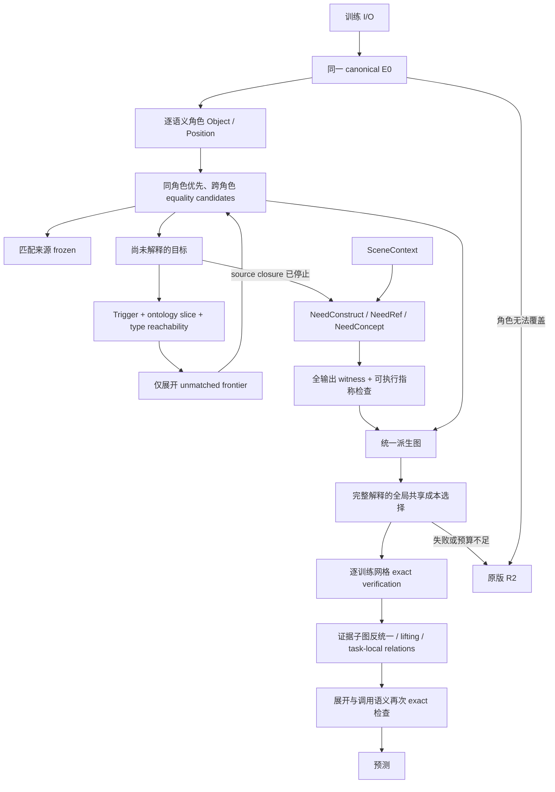

# LATIS v0.4 — Triggered Typed Feature Saturation

本版新增 `solve-v04`，优先运行 declarative feature front-end；失败时，以原配置和原训练集调用 `Synthesis.InducedR2.Learn.inducedSearch Full`。R2 源码与旧入口未修改。此前的 `solve-features` 实验入口也保留，但不承担 v0.4 的实现。

## 运行

```powershell
cabal --config-file=scripts/cabal.config run latis --offline -- solve-v04 --task data/03560426.json --out results/v04/03560426 --mode Full
cabal --config-file=scripts/cabal.config run latis --offline -- v04-stress --out results/v04/stress
cabal --config-file=scripts/cabal.config run latis --offline -- v04-r2-stress --out results/v04/r2-baseline
cabal --config-file=scripts/cabal.config test triggered-tests latis-tests feature-pipeline-tests induced-r2-tests --offline --test-show-details=direct
python scripts/report_v04.py
```

前端默认 source budget=12000、construction budget=12000、selection budget=100000、depth=4。CLI 对应 `--feature-budget`、`--construction-budget`、`--selection-budget`、`--feature-depth`。`--budget` 是独立的 R2 work budget，默认 250000；前端工作不从它扣除。API 支持零预算与完整 R2 配置。

## 数据流



## 表示、匹配与触发

每个角色有两个初始特征：ObjectT 是局部稀疏几何及颜色，位置归零；CoordT 是位置。特征保存跨案例 vector、symbolic term、role、history、cost、status、depth。根节点记录 grounding ID 仅作诊断；执行表达式没有 ID observer。输出目标以独立 target 节点序列化。

角色语法支持唯一物体、唯一指定颜色物体、全体或指定颜色中的水平／垂直极值。并列不按扫描次序消歧。当前跨案例角色覆盖要求固定的一组可定义角色，覆盖所有对象；可变对象数量不在这个原型的前端覆盖范围内。

`rematch` 使用 `(Type, denotation vector)` 查找所有 equality 候选。同角色候选排在前面，但不会提交为唯一解释。所有已匹配来源立即冻结，下一次普通展开前再次检查状态。AnchorOffset 可以以 active Position 为主参数，将同角色的 frozen Object 作为显式 `NeedRef` 的只读参数。

算子注册表按 `(ontology slice, input type)` 建索引；Full 只查询当前需求解锁的 slice。可见 operator type graph 再做 reachability 检查。注册表存在不代表算子会被枚举执行。原型固定 slice 包括 Geometry、Palette、Displacement、AnchorRelation、ConceptSlice；200 个压力噪声算子放在未触发的 ConceptSlice。

每条生成 hyperedge 保存 trigger、parent goal、type reason、ontology slice、provenance；额外依赖与固定标量参数也分别保存 evidence。`NeedExplain`、`NeedTransform`、`NeedRef`、`NeedConcept`、`NeedConstruct`、`NeedRelation` 用于生成／构造；`RefinementTrigger` 与 `FailureTrigger` 用于受限 refinement/widening 接口。消融放宽也使用显式 FailureTrigger，不制造匿名无依据展开。

## 原型算子范围

使用与既有 canonical 语义相同的 D4、recolor、四个单位坐标步进及四个局部锚点偏移。它们是小型 typed wrapper registry，并非把完整 R2 Base/TSL 无条件搬进前向闭包。没有任务 ID 分支，也没有 Attach、At、Chain 结构模板。

多参数 AnchorOffset 只连接同角色的初始 Object；没有任意参数 Cartesian product。定义按名称共享，每次应用仍须在全部案例上执行。NoTransformReuse 对每次应用重新收取定义构建费用，并在解释成本中不共享定义。

Semantic state 合并同类型、同 vector 的表达式；所有不同结构代表保留，没有 alias≤2 上限。结构索引避免重复插入完全相同的表达式。不同路径仍可能产生很多别名，因此保留深度、source 与 selection 三类独立限制。

## SceneContext 与 output-wise witness

SceneContext 不在初始 feature 集合、source frontier 或 operator index 中。source closure 因无增长、深度限制或预算停止后，才为未解释目标解锁 construction。Decoder 若需要改变画布布局，也在 source closure 之后触发 SceneT construction；相同布局直接沿用 canonical decoder 的输入布局契约。

每个目标 witness 同时保留所有案例的 input context、output context 与 required value。新表达式必须在可用 input context／已解析输出依赖上重放，满足全部目标 vector。GridBR 等引用在运行时按已确定的输出尺寸求值，绝不读取预测目标网格。输出依赖使用 `Output target` 表示；全局选择之后重新求值，检测循环和缺失依赖。

引用搜索优先于构造。引用包括画布锚点、语义选中对象及其锚点。构造概念复用 `FeaturePipeline.outputWitness` 的全输出矩形语法：单色实心矩形，大小为共享常量或画布维度，锚点对齐。具体坐标与对象表不会作为 invented relation 的捕获值保存。泛型稀疏形状生成、遮挡推理、递归对象数量和任意算术 reference 尚未覆盖。

## 全局解释和关系

有限派生图中的所有完整候选通过 branch-and-bound 比较，成本包含 unique definition、call、reference，以及构造常量的 groundedness penalty。选择依据只使用训练案例；heldout 仅用于选择后的审计。选择预算不足时不声称最优，也不返回一个未经完整选择的前端解，而是 fallback。

`optimal_within_generated_graph` 指关系压缩前、已生成 feature candidates 上的共享成本最优，不是无限 DSL 中的全局最优。关系抽取从成功匹配的派生子图进行 typed structural anti-unification：保留共同调用拓扑，将不同 root/ref 提升成 typed parameters，并保留重复参数的依赖一致性。

接受评分记录 compression gain、search-reduction estimate、decoupling gain、coverage。后两者使没有立即 AST 压缩收益、但有重复可复用结构的候选也可被接受。`search_reduction` 明确是结构估计，不能解释成已测得后续搜索加速。

接受的匿名 I_k 注册为 task-local operator；最终程序实际调用它们，并再次 exact 验证。较大关系可引用较小关系，level 自动为依赖最大 level+1。refinement 只能返回记录的依赖边，未经 FailureTrigger 的 widening 被拒绝。

本轮关系发现位于完整解释之后，未实现“中途发现新关系并重新调度未完成 saturation”的在线反馈。因此 NoRelationInvention/FlatRelations 当前主要验证执行表示、参数隔离及层级约束，不能用它们声称搜索量改进。关系的类型／refinement 接口已可用于下一轮调度扩展。

## 消融定义

| Mode | 行为 |
|---|---|
| Full | 需求可见性、冻结剪枝、定义共享、lifting、context、关系 |
| NoMatchedFeaturePruning | 允许冻结节点继续普通展开 |
| NoVisibility | 保留类型相关性，但显式解锁所有注册 slice |
| NoIntensionalLifting | 关闭 context reference 与 concept lifting |
| NoTransformReuse | 重复收取定义工作与定义成本 |
| NoSceneContext | 禁止 context construction/reference |
| NoRelationInvention | 不生成匿名关系，执行原始 feature terms |
| FlatRelations | 关系展开为直接 Base 依赖，level=0 |
| DirectBaseExpansion | 全 slice、无冻结剪枝、无关系发现 |
| R2FallbackOnly | 跳过前端，直接调用原版 R2 |

`v04-stress` 隔离前端机制；其中 R2FallbackOnly 为禁用前端的零工作对照，不能当作 R2 性能。`v04-r2-stress` 另外真实执行 A–G 的 R2FallbackOnly，并保存独立 work 和预测。H 由 `solve-v04` 验证真实 fallback。

## Metrics 与预算

source budget 包含逐案例 operator evaluation 以及首次定义构建的符号费用；NoTransformReuse 每次收取。construction budget 包含 reference／concept 全案例检查及矩形 witness 工作。selection budget 限制 branch-and-bound 节点。所有完整向量检查均预留预算，避免半个案例向量被错误接受。

最终 `search_work = source_search_work + construction_work + selection_work`。这是可复现的逻辑工作计数，不等于 CPU 指令、秒数或 R2 的 expanded-work 单位。role grounding、匹配索引维护、图序列化与最终 exact verification 不计入该逻辑预算；耗时另外记录。`visibility_size` 为累计候选数，ratio 的分母是累计 type-compatible opportunities。

两个硬性零值由图审计计算：无 evidence 的展开、以及非参数化的 relation capture 都会使对应计数增加。负向单元测试验证 exposure 审计并非硬编码零。完整 artifacts 包括 `solution.json`、`derivation_graph.json`、触发后才填充的 `contexts.json`、`trace.txt` 和可选 `r2-fallback/`。

## 兼容性界限

前端失败不会缩减 R2 的预算、语言或配置。一个前端训练 exact 的假设仍可能在未知案例上泛化失败；本原型不声称对所有 ARC heldout 都不劣于 R2，也没有用测试标签选择是否 fallback。实测范围及负结果见根目录 `LATIS_V04_REPORT.md`。
