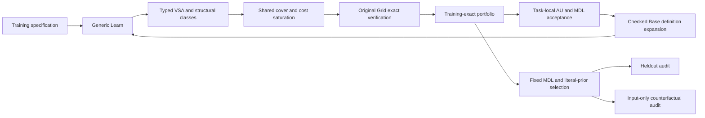

# LATIS v0.3R.2

固定 Base、獨立 `solve-v03r2` 已實作。StructuralPriorCount=0；03560426 train/heldout exact。17 個 regression：train=16/17、heldout=16/17。這是實測結果，沒有將未達成的 17/17 改寫為完成。

## 可重現協議與資料邊界

`python scripts/check_v03r2_tests.py`，`python scripts/run_v03r2.py --timeout 300`，再 `python scripts/make_v03r2_report.py`。本報告校驗 226 個獨立執行的 source/binary/input fingerprints，並校驗六套 tests PASS。Base SHA256：`97da19a29cd2b1c2ecbcf8e03644151ecb4a02ba2b3af0e79f75e3bd9fe085f0`，與 R/R.1 完全相同。舊 R/R.1 source 與 frozen data 由 runner 校驗；兼容測試的新輸出保存於 R2 目錄。

本輪 execution orchestration：groups 並行、group 內逐題/逐模式順序執行；16 logical cores。每題為獨立 solver process，沒有共享 task dictionary。實際 group outputs 與 protocol 在 orchestration.json 中記錄；report 直接校验各輸出目錄，不改寫原 command。 同一 host 的其他負載與 group 競爭可能影響 wall-clock；本輪不宣稱隔離 CPU benchmark 或普遍 wall-clock 加速。離散 search-work/candidate 選擇不依賴調度時間。

最終矩陣前的 hardening 修正了兩個反例：相同 literal multiset 在不同 coefficient/bias slots 不再合併；同名 let 的 strict use 不再讓外部 partial expression 被提到未選中的 lazy branch 之外。兩項均有測試。先前 120 秒的局部矩陣及其 84 個 source snapshots 保留於 `results/v03r2-before-hardening`，不混入本報告統計。最終 deadline 採 300 秒，work/cost/depth/frontier bounds 沒有提高。

設定：總工作 budget=250000；diagnostic budget=25000；effective MDL/prior cost bound=96；每次 saturation refinement 工作上限=25000；deductive recursion safety guard=7，與 R.1 相同；Full 不使用 frontier=32 或 alias≤2。frame/functional observations 自固定 Base 組合生成。沒有增加 Base primitive、neural、cross-task library、sequence/scan/Attach/Progression family，也沒有提高 depth/frontier。

`results/v03r2/protocol.json`、各題 `execution.json` 保存具體 command、hash 與 deadline。`metrics.csv` 保存所有已完成執行的指標；timeout 的缺失計數是 n/a，不能當零。30 ARC 只稱 **PreviouslyOpenedDiagnosticSet**。training labels 用於 specification 與 exact verification；heldout labels 只在固定選擇之後審計 portfolio。hypothetical predictions 也只作後置診斷。

H 與 D 均無回流到 Learn 或選擇的邊；acceptance 只使用 training-exact frontier。

## 等價類與結構代表

等價類的 key 是 exact input/environment context + typed denotation vector。上下文透過共享編號儲存，完整資料在 `contexts.json`；不是用可能碰撞的 hash 判定等價。Leaf 記錄 type、FV/dependency、literal/observer provenance、effects、typed structural form 和 MDL。Union/Join 保存約束與子節點；其多個結構代表由 alternatives 表示，不捏造一個單一 FV/signature。exact-verified 根程序以 certificate leaves 保存，原 symbolic DAG 同時保留。

子問題的 denotation 是實際 Base value（已匹配的 Point/FunctionPoint 以 required values 重用），relational ordering keys 則求值。最終 root-certificate 的 denotation 是 exact-rendered Grid 對應的 canonical encoded target Scene：它表示 Render/Encode observation equality，而不宣稱內部 object IDs、list order 等未觀測表示完全相同。這些最後加入的根 certificates 不參與 initializer feedback。需保留此觀測層區別才能正確解讀 JSON。

Full 每個 denotation/signature 保存最佳代表。literal `10` 與 `width(scene)-1`、width/height dependency、不同數值係數、不同 order/key/functional structure 可同時存活。alpha-renaming 和白名單 Base identities（例如 index-0/head、整數 identity、相同 anchor projection）只合併全輸入成立的 syntax identities；不是用 training equality 合併泛化假設。簽名使用線性大小編碼，避免巢狀轉義膨脹。

`pruned_representatives` 計 observer-domain 去重/消融刪除；Full 的正常去重是相同 canonical signature，不能把此欄解讀為所有 saturation-product prune 次數。`structural_representatives` 包括子問題與根 class；root portfolio 大小和 held-correct candidate 數另列。完整類別在 `equivalence_classes.json`，不是只輸出最短兩個 aliases。

## 通用共享與搜索調度

`Sharing` 用既有 Base let 生成 scope-safe CSE。initializer 只編碼一次，每個 reference 仍有成本；可將 sorted list 同時用於 head、seed 內的 anchor 和 tail。它不把可能失敗的 head 移出未選中的 lazy branch，也不跨越被遮蔽的 binder。compiler-generated local lets 在更大 scope 中重算，避免局部 CSE 妨礙全局共享。

單獨替換 seed 的 source 或 displacement observer，可能產生互相不一致的同值 aliases。`AliasSharing` 根據 VSA 的 observational class 替換共享 initializer，同時改變所有 references，再做普通 Base CSE。這能讓 reverse-order 的 seed、anchor 和 tail 使用同一 sorted expression。每個 proposal 都重新 kernel-typecheck、驗證原 training Grid；不根據 heldout 或 hypothetical output 接受它。這是 generic let congruence，沒有 reverse/Attach 專用 witness。

原始 Cartesian product 可能在任何完整根 AST 出現前耗盡 budget。新增 `PortfolioCover` 先遍歷既有 deductive DAG 的完整 witnesses 與 single-hole alternatives，以實際共享成本作局部調度，保留原 DAG 的全部其餘選擇。然後 cost saturation 按 C=1,2,… activation，記住已處理的 correlated products，較昂貴項留在 pending/DAG。cover 是有限的可行候選覆蓋，**不是完整 Cartesian enumeration，也不是全局最優 MDL 證明**。

`cost_bound_reached` 只指 saturation refinement 到達的 stratum，budget 可能在 stratum 內截止。cover 已有的完整候選受 configured cost bound 約束，不能把 C reached 解讀為所有 root representatives 的最大 cost。有限 witness domains、原 7 層 deductive safety guard、forward-terminal policy、工作與 cost bounds 都仍限制 Reachable；沒有宣稱完整 cost-optimal synthesis。

## Grounded-literal prior 與消融定義

ranking = shared code length + 8 × unexplained numeric-literal coding cost + 1 × effect cost。0/1/−1 低成本；其他 Int 及 Coord/Vec/Size components 按數值 bit length 加罰；有限 color/anchor/D4 enums 不加該罰。input-grounded arithmetic 不另加 task-specific literal penalty。這是明示 prior，會影響 effective cost scheduling 和選擇；NoGroundedLiteralPrior 將它設為零，不能將實測勝利推成此 prior 永遠正確。

`grounded_expressions` 是 compatibility metric：計 zero-unexplained-numeric-penalty expressions，包含 universal constants，不能等同於全部表達式因果上依賴 input。input dependence 看 FV/dependency/observer provenance；literal provenance 保存實際值。CSV 另從 selected typed AST 計 universal-small 和 unexplained numeric components（含 Coord/Vec/Size components），與 selected penalty 分開，避免將 coding cost 當作 literal 次數。

NoDiversityPreservation 的有限 observer/domain 與每次 extraction node 保留一個代表；FixedAliasCap 在這些位置保留兩個。relational key constraints 的不同 key denotations 不被當成同值 aliases；online rounds 的舊 portfolio 與新 alternatives 仍合併，故最終 root portfolio 可以多於該局部 cap。這不是對最終 union 再做硬性 post-hoc cap。NoLetSharing 關閉 CSE、shared-initializer feedback 和 generic let deduction。BeamSearchLegacy 使用原 depth/frontier ranked materialization。NoCounterfactualDiagnosis 關閉後置 input audit；它與 Full 的 selected program/portfolio 一致性已由 generator 校驗。

## 完整消融

每格為 train exact ; heldout exact。

| Mode | 03560426 train ; heldout | 17 regression | A–J | 30 diagnostics |
| --- | --- | --- | --- | --- |
| Full | 1/1 ; 1/1 | 16/17 ; 16/17 | 9/10 ; 6/10 | 1/30 ; 0/30 |
| NoDiversityPreservation | 1/1 ; 1/1 | 16/17 ; 15/17 | 9/10 ; 5/10 | n/a |
| FixedAliasCap | 1/1 ; 1/1 | 16/17 ; 16/17 | 9/10 ; 5/10 | n/a |
| NoLetSharing | 1/1 ; 1/1 | 16/17 ; 15/17 | 9/10 ; 5/10 | n/a |
| NoGroundedLiteralPrior | 1/1 ; 1/1 | 16/17 ; 15/17 | 9/10 ; 5/10 | n/a |
| BeamSearchLegacy | 1/1 ; 1/1 | 16/17 ; 15/17 | 9/10 ; 5/10 | n/a |
| NoCounterfactualDiagnosis | 1/1 ; 1/1 | 16/17 ; 16/17 | 9/10 ; 6/10 | n/a |

| Set | Full diagnosis |
| --- | --- |
| core | {'None': 1} |
| regression | {'None': 16, 'BaseExpressibilityUnknown': 1} |
| stress | {'None': 6, 'AbstractionMissing': 3, 'WitnessMissing': 1} |
| diagnostic | {'BaseExpressibilityUnknown': 17, 'WitnessMissing': 2, 'SpecificationRepresentationMissing': 3, 'SearchFailure': 7, 'AbstractionMissing': 1} |

### 與凍結 R.1 的覆蓋比較

| Frozen v0.3R.1 Full set | train ; heldout | R2 Full train ; heldout |
| --- | --- | --- |
| regression | 16/17 ; 14/17 | 16/17 ; 16/17 |
| stress | 9/10 ; 5/10 | 9/10 ; 6/10 |
| diagnostic | 2/30 ; 1/30 | 1/30 ; 0/30 |

此表比較同一固定資料的 coverage；兩版 observer、ranking、materialization protocol 不同，不作 wall-clock 或單一機制的受控比較。上面的本輪消融才使用相同 binary、總 budget、cost 與 input hashes。

## 17 個 regression 的 portfolio 審計

held-correct portfolio 數量只在選擇後計算，不回饋 search 或 ranking。

| Task | train | heldout | held-correct candidates | portfolio | failure | ambiguity diagnosis |
| --- | --- | --- | --- | --- | --- | --- |
| constant-transform | True | True | 1412 | 1412 | None | ObservationallyUnderdetermined |
| equivalent-expressions | True | True | 510 | 510 | None | ObservationallyUnderdetermined |
| filter-color | True | True | 122 | 142 | None | ObservationallyUnderdetermined |
| fold-bbox | False | False | 0 | 0 | BaseExpressibilityUnknown | NoDistinguishingInputFoundWithinBounds |
| grid-without-prev | True | True | 2976 | 3115 | None | ObservationallyUnderdetermined |
| iterate-chain | True | True | 299 | 299 | None | ObservationallyUnderdetermined |
| map-recolor | True | True | 1412 | 1412 | None | ObservationallyUnderdetermined |
| map-reflectH | True | True | 1412 | 1412 | None | ObservationallyUnderdetermined |
| map-rotate90 | True | True | 1412 | 1412 | None | ObservationallyUnderdetermined |
| map-scan-ambiguity | True | True | 302 | 310 | None | NoDistinguishingInputFoundWithinBounds |
| map-translate | True | True | 168 | 228 | None | NoDistinguishingInputFoundWithinBounds |
| scan-BL-TL | True | True | 1 | 1 | None | NoDistinguishingInputFoundWithinBounds |
| scan-BR-TL | True | True | 1 | 1 | None | NoDistinguishingInputFoundWithinBounds |
| scan-TR-TL | True | True | 1 | 1 | None | NoDistinguishingInputFoundWithinBounds |
| scan-reverse | True | True | 60 | 2015 | None | ObservationallyUnderdetermined |
| true-scan-lazy-prev | True | True | 1118 | 1423 | None | ObservationallyUnderdetermined |
| wrong-early-skeleton | True | True | 371 | 392 | None | ObservationallyUnderdetermined |

## 三個重點目標與成本

| Task | Mode | train/held | held-correct portfolio | classes | reps | max/class | observer pruned | C reached | selected lets | selected literal penalty | first exact work | total work | exact calls | process seconds |
| --- | --- | --- | --- | --- | --- | --- | --- | --- | --- | --- | --- | --- | --- | --- |
| 03560426 | Full | 1/1 | 216 | 44 | 538 | 294 | 36734 | 33 | 1 | 0 | 58956 | 151856 | 583 | 66.641 |
| 03560426 | NoDiversityPreservation | 1/1 | 1 | 44 | 47 | 2 | 59914 | 96 | 1 | 0 | 19489 | 19544 | 1 | 23.766 |
| 03560426 | FixedAliasCap | 1/1 | 3 | 44 | 64 | 3 | 55434 | 96 | 1 | 0 | 19750 | 21578 | 6 | 27.687 |
| 03560426 | NoLetSharing | 1/1 | 212 | 44 | 531 | 287 | 36734 | 34 | 0 | 0 | 46456 | 118202 | 569 | 54.0 |
| 03560426 | NoGroundedLiteralPrior | 1/1 | 217 | 44 | 539 | 295 | 36734 | 33 | 1 | 10 | 58954 | 151578 | 585 | 68.484 |
| 03560426 | BeamSearchLegacy | 1/1 | 32 | 19 | 56 | 32 | 60686 | 0 | 0 | 0 | 6487 | 56698 | 48 | 40.609 |
| 03560426 | NoCounterfactualDiagnosis | 1/1 | 216 | 44 | 538 | 294 | 36734 | 33 | 1 | 0 | 58956 | 151856 | 583 | 68.203 |
| grid-without-prev | Full | 1/1 | 2976 | 24 | 3363 | 3115 | 2413 | 48 | 0 | 0 | 34301 | 80277 | 3115 | 67.218 |
| grid-without-prev | NoDiversityPreservation | 1/1 | 1 | 24 | 24 | 1 | 4386 | 96 | 0 | 0 | 1494 | 1527 | 1 | 0.704 |
| grid-without-prev | FixedAliasCap | 1/1 | 2 | 24 | 40 | 2 | 4260 | 96 | 0 | 0 | 1703 | 2274 | 2 | 0.813 |
| grid-without-prev | NoLetSharing | 1/1 | 2535 | 24 | 2922 | 2674 | 2413 | 50 | 0 | 0 | 28461 | 68597 | 2674 | 53.0 |
| grid-without-prev | NoGroundedLiteralPrior | 1/0 | 18 | 24 | 611 | 363 | 2413 | 30 | 0 | 10 | 35607 | 128620 | 390 | 31.484 |
| grid-without-prev | BeamSearchLegacy | 1/1 | 1 | 24 | 49 | 18 | 4215 | 0 | 0 | 0 | 1650 | 12073 | 18 | 2.922 |
| grid-without-prev | NoCounterfactualDiagnosis | 1/1 | 2976 | 24 | 3363 | 3115 | 2413 | 48 | 0 | 0 | 34301 | 80277 | 3115 | 62.078 |
| scan-reverse | Full | 1/1 | 60 | 69 | 2761 | 2015 | 36734 | 23 | 1 | 0 | 61177 | 178294 | 3889 | 107.765 |
| scan-reverse | NoDiversityPreservation | 1/0 | 0 | 69 | 74 | 2 | 63672 | 96 | 1 | 0 | 15046 | 15119 | 1 | 16.344 |
| scan-reverse | FixedAliasCap | 1/1 | 4 | 69 | 117 | 6 | 60957 | 96 | 1 | 0 | 15675 | 20490 | 12 | 19.938 |
| scan-reverse | NoLetSharing | 1/0 | 0 | 69 | 1869 | 1123 | 36734 | 23 | 0 | 0 | 48677 | 138084 | 2177 | 74.688 |
| scan-reverse | NoGroundedLiteralPrior | 1/1 | 66 | 69 | 2609 | 1863 | 36734 | 23 | 1 | 12 | 61053 | 178732 | 3591 | 103.515 |
| scan-reverse | BeamSearchLegacy | 1/0 | 0 | 47 | 73 | 14 | 62430 | 0 | 0 | 0 | 10353 | 25608 | 24 | 16.906 |
| scan-reverse | NoCounterfactualDiagnosis | 1/1 | 60 | 69 | 2761 | 2015 | 36734 | 23 | 1 | 0 | 61177 | 178294 | 3889 | 107.156 |

grid-without-prev Full heldout=True，NoDiversityPreservation heldout=True。其 Full 選擇為 `(lambda v0:SceneT. mkScene(canvasSize(v0),ColorV 0,map((lambda v1:PlacedT. Translate(v1,coordDelta(coord(add(width(canvasSize(v0)),IntV (-1)),add(height(canvasSize(v0)),IntV (-1))),Anchor(v1,BR)))),objects(v0))))`。這組消融不能把恢復單獨歸因於 diversity。

NoGroundedLiteralPrior heldout=False，portfolio 中仍有 18 個 heldout-correct candidates；選中 `(lambda v0:SceneT. mkScene(canvasSize(v0),ColorV 0,map((lambda __r1b0:PlacedT. Translate(__r1b0,vec(IntV 10,add(colorToInt(head(setToList(ObjectColors(objectOf(__r1b0))))),IntV 9)))),objects(v0))))`。如果正確候選已存在而選錯，這是 ranking/inductive bias 的直接證據，不是候選丟失。

scan-reverse Full heldout=True，NoLetSharing heldout=False（heldout-correct candidates=0），NoDiversityPreservation heldout=False。Full 的選擇為 `(lambda v0:SceneT. let __cse0=sortBy((lambda key:PlacedT. subtract(IntV 0,x(Anchor(key,BR)))),objects(v0)) in mkScene(canvasSize(v0),ColorV 0,scan((lambda __r1b0:PairT PlacedT PlacedT. Translate(snd(__r1b0),coordDelta(Anchor(fst(__r1b0),BR),Anchor(snd(__r1b0),TL)))),Translate(head(__cse0),coordDelta(CoordV (Coord {cx = 0, cy = 0}),Anchor(head(__cse0),TL))),tail(__cse0))))`。所有排序、scan、head/tail 和 let 均為固定 Base；完整表格區分候選 coverage 與最終選擇。

`first_solution_states` 在首次 original Grid exact verification 成功時記錄，發生於 online discovery 之前；它不是 hypothetical probe work。total work 包括 deduction、row comparisons、definition expansion、cover、alias substitution、saturation 和 discovery 的離散操作。exact calls 計 cache misses 的原 training verifier calls；最終 heldout portfolio audit 不混入它。cost/observer 列、let sharing、grounded/ungrounded coding cost 和 exact calls 的完整值在 CSV/JSON。

| Task | cover work | shared alias work | all extraction work | discovery work | invention hits | deduction ms | extraction ms | discovery ms | exact ms | solver seconds | process seconds |
| --- | --- | --- | --- | --- | --- | --- | --- | --- | --- | --- | --- |
| 03560426 | 7905 | 37500 | 120405 | 12324 | 1 | 28171 | 29689 | 3368 | 0 | 61.8 | 66.641 |
| grid-without-prev | 4326 | 11680 | 66006 | 12972 | 0 | 937 | 31752 | 3946 | 13 | 41.391 | 67.218 |
| scan-reverse | 31109 | 37500 | 143609 | 20306 | 1 | 21959 | 48554 | 6547 | 0 | 82.493 | 107.765 |

extraction 包含 cover、shared aliases 和 saturation。solver seconds 與 process seconds 分開：後者還包含 ambiguity diagnosis、heldout portfolio audit 和 JSON export。離散工作不是 CPU instruction 或完整 eval steps，不能用它推論普遍 wall-clock 加速。階段毫秒採 integer resolution；exact verification 對每次 cache miss 的 duration 先取整再累加，故很多少於 1ms 的 calls 可顯示為 0ms，不能解讀成沒有驗證或零 CPU cost。

### 額外 portfolio-cover 消融

NoPortfolioCover 同時關閉 complete-witness cover 與 correlated shared-initializer extraction；cost strata、25k refinement budget、總 budget 和 Base 不變。它測試這組通用 materialization 改動，不能將差異全部歸因於單一子機制。

| Task | train | heldout | failure | symbolic root | portfolio | first exact work | total work | process seconds |
| --- | --- | --- | --- | --- | --- | --- | --- | --- |
| 03560426 | 0 | 0 | SearchFailure | 295 | 0 | 0 | 44118 | 48.047 |
| grid-without-prev | 1 | 1 | None | 3260 | 2976 | 26298 | 64271 | 69.579 |
| scan-reverse | 0 | 0 | SearchFailure | 851 | 0 | 0 | 39373 | 37.531 |

沒有觀察到 process/solver 相差超過 300 秒的外部計時異常。

## Counterfactual ambiguity

| Set | Full concrete underdetermination witnesses | no witness within bounds | timeouts |
| --- | --- | --- | --- |
| core | 1 | 0 | 0 |
| regression | 11 | 6 | 0 |
| stress | 3 | 7 | 0 |
| diagnostic | 1 | 27 | 2 |

診斷檢查最多 12 個按該 mode ranking 的 structural hypotheses，以 training inputs 的尺寸、位置、角落像素與背景擾動構造最多 128 個 hypothetical inputs。按 object count、canvas area、文字順序尋找第一個兩個有效 predictions 不同的 input。這是有限 domain 中的簡單性次序，**不是全輸入空間的 argmin 證明**。輸出 `ObservationallyUnderdetermined`、distinguishing input 與兩個 predictions；selection_feedback=false。沒有找到 witness 只表示此 domain/pair bound 內未找到，不能表示規則唯一。

### 03560426

P1: `(lambda v0:SceneT. let __cse0=sortBy((lambda key:PlacedT. x(Anchor(key,BR))),objects(v0)) in mkScene(canvasSize(v0),ColorV 0,scan((lambda __r1b0:PairT PlacedT PlacedT. Translate(snd(__r1b0),coordDelta(Anchor(fst(__r1b0),BR),Anchor(snd(__r1b0),TL)))),Translate(head(__cse0),coordDelta(CoordV (Coord {cx = 0, cy = 0}),Anchor(head(__cse0),TL))),tail(__cse0))))`

P2: `(lambda v0:SceneT. let __cse0=sortBy((lambda key:PlacedT. x(Anchor(key,BR))),objects(v0)) in mkScene(canvasSize(v0),ColorV 0,scan((lambda __r1b0:PairT PlacedT PlacedT. Translate(snd(__r1b0),coordDelta(Anchor(fst(__r1b0),BR),Anchor(snd(__r1b0),TL)))),Translate(head(__cse0),vec(IntV 0,multiply(IntV (-1),y(Anchor(head(__cse0),TL))))),tail(__cse0))))`

Distinguishing input: 10×10，其全部非零 cells（x,y,color）為 `[(1, 6, 8), (2, 6, 8), (3, 6, 8), (1, 7, 8), (2, 7, 8), (3, 7, 8), (1, 8, 8), (2, 8, 8), (3, 8, 8), (4, 8, 7), (5, 8, 7), (7, 8, 2), (8, 8, 2), (9, 8, 2), (1, 9, 8), (2, 9, 8), (3, 9, 8), (4, 9, 7), (5, 9, 7), (7, 9, 2), (8, 9, 2), (9, 9, 2)]`；其餘 cells=0。兩個完整 hypothetical predictions 見 [solution.json](../../results/v03r2/core/03560426/Full/solution.json)。此 input 未提供真實 output，不參與選擇。

### grid-without-prev

P1: `(lambda v0:SceneT. mkScene(canvasSize(v0),ColorV 0,map((lambda v1:PlacedT. Translate(v1,coordDelta(coord(add(width(canvasSize(v0)),IntV (-1)),add(height(canvasSize(v0)),IntV (-1))),Anchor(v1,BR)))),objects(v0))))`

P2: `(lambda v0:SceneT. mkScene(canvasSize(v0),ColorV 0,map((lambda v1:PlacedT. Translate(head(objects(v0)),coordDelta(coord(add(width(canvasSize(v0)),IntV (-1)),add(height(canvasSize(v0)),IntV (-1))),Anchor(v1,BR)))),objects(v0))))`

Distinguishing input: 14×16，其全部非零 cells（x,y,color）為 `[(2, 3, 1), (2, 4, 1), (2, 5, 1), (3, 5, 1), (13, 15, 1)]`；其餘 cells=0。兩個完整 hypothetical predictions 見 [solution.json](../../results/v03r2/regression/grid-without-prev/Full/solution.json)。此 input 未提供真實 output，不參與選擇。

### scan-reverse

P1: `(lambda v0:SceneT. let __cse0=sortBy((lambda key:PlacedT. subtract(IntV 0,x(Anchor(key,BR)))),objects(v0)) in mkScene(canvasSize(v0),ColorV 0,scan((lambda __r1b0:PairT PlacedT PlacedT. Translate(snd(__r1b0),coordDelta(Anchor(fst(__r1b0),BR),Anchor(snd(__r1b0),TL)))),Translate(head(__cse0),coordDelta(CoordV (Coord {cx = 0, cy = 0}),Anchor(head(__cse0),TL))),tail(__cse0))))`

P2: `(lambda v0:SceneT. let __cse0=head(sortBy((lambda key:PlacedT. cardinality(ObjectCells(objectOf(key)))),objects(v0))) in mkScene(canvasSize(v0),ColorV 0,scan((lambda __r1b0:PairT PlacedT PlacedT. Translate(snd(__r1b0),coordDelta(Anchor(fst(__r1b0),BR),Anchor(snd(__r1b0),TL)))),Translate(__cse0,coordDelta(CoordV (Coord {cx = 0, cy = 0}),Anchor(__cse0,TL))),tail(sortBy((lambda key:PlacedT. subtract(IntV 0,x(Anchor(key,BR)))),objects(v0))))))`

Distinguishing input: 18×18，其全部非零 cells（x,y,color）為 `[(7, 9, 2), (8, 9, 2), (7, 10, 2), (8, 10, 2), (2, 11, 4), (3, 11, 4), (4, 11, 4), (7, 11, 2), (8, 11, 2), (12, 11, 6), (13, 11, 6), (2, 12, 4), (3, 12, 4), (4, 12, 4), (7, 12, 2), (8, 12, 2), (12, 12, 6), (13, 12, 6), (12, 13, 6), (13, 13, 6)]`；其餘 cells=0。兩個完整 hypothetical predictions 見 [solution.json](../../results/v03r2/regression/scan-reverse/Full/solution.json)。此 input 未提供真實 output，不參與選擇。

完整 Full witnesses 亦集中保存於 `results/v03r2/counterfactual_witnesses.json`。

### 剩餘錯誤的搜索 / 選擇診斷

| Set | Task | solver taxonomy | post-selection diagnosis | counterfactual audit |
| --- | --- | --- | --- | --- |
| regression | fold-bbox | BaseExpressibilityUnknown | no training-exact candidate in bounded portfolio; expressibility unresolved | NoDistinguishingInputFoundWithinBounds |
| stress | C-scene-axis | AbstractionMissing | bounded portfolio coverage: no heldout-correct candidate; absence is not BaseMissing | ObservationallyUnderdetermined |
| stress | E-local-better | AbstractionMissing | bounded portfolio coverage: no heldout-correct candidate; absence is not BaseMissing | NoDistinguishingInputFoundWithinBounds |
| stress | G-fusion | AbstractionMissing | bounded portfolio coverage: no heldout-correct candidate; absence is not BaseMissing | ObservationallyUnderdetermined |
| stress | H-overfitting-trap | WitnessMissing | no training-exact candidate in bounded portfolio; expressibility unresolved | NoDistinguishingInputFoundWithinBounds |
| diagnostic | 1bfc4729 | BaseExpressibilityUnknown | no training-exact candidate in bounded portfolio; expressibility unresolved | NoDistinguishingInputFoundWithinBounds |
| diagnostic | 1fad071e | BaseExpressibilityUnknown | no training-exact candidate in bounded portfolio; expressibility unresolved | NoDistinguishingInputFoundWithinBounds |
| diagnostic | 23b5c85d | WitnessMissing | no training-exact candidate in bounded portfolio; expressibility unresolved | NoDistinguishingInputFoundWithinBounds |
| diagnostic | 2dc579da | WitnessMissing | no training-exact candidate in bounded portfolio; expressibility unresolved | NoDistinguishingInputFoundWithinBounds |
| diagnostic | 363442ee | BaseExpressibilityUnknown | no training-exact candidate in bounded portfolio; expressibility unresolved | NoDistinguishingInputFoundWithinBounds |
| diagnostic | 36d67576 | SpecificationRepresentationMissing | no training-exact candidate in bounded portfolio; expressibility unresolved | NoDistinguishingInputFoundWithinBounds |
| diagnostic | 39e1d7f9 | SpecificationRepresentationMissing | no training-exact candidate in bounded portfolio; expressibility unresolved | NoDistinguishingInputFoundWithinBounds |
| diagnostic | 3eda0437 | BaseExpressibilityUnknown | no training-exact candidate in bounded portfolio; expressibility unresolved | NoDistinguishingInputFoundWithinBounds |
| diagnostic | 40853293 | BaseExpressibilityUnknown | no training-exact candidate in bounded portfolio; expressibility unresolved | NoDistinguishingInputFoundWithinBounds |
| diagnostic | 4347f46a | BaseExpressibilityUnknown | no training-exact candidate in bounded portfolio; expressibility unresolved | NoDistinguishingInputFoundWithinBounds |
| diagnostic | 469497ad | BaseExpressibilityUnknown | no training-exact candidate in bounded portfolio; expressibility unresolved | NoDistinguishingInputFoundWithinBounds |
| diagnostic | 484b58aa | SearchFailure | external budget/search timeout | n/a |
| diagnostic | 54d9e175 | BaseExpressibilityUnknown | no training-exact candidate in bounded portfolio; expressibility unresolved | NoDistinguishingInputFoundWithinBounds |
| diagnostic | 5521c0d9 | SearchFailure | no training-exact candidate in bounded portfolio; expressibility unresolved | NoDistinguishingInputFoundWithinBounds |
| diagnostic | 5ad4f10b | SearchFailure | no training-exact candidate in bounded portfolio; expressibility unresolved | NoDistinguishingInputFoundWithinBounds |
| diagnostic | 5c2c9af4 | BaseExpressibilityUnknown | no training-exact candidate in bounded portfolio; expressibility unresolved | NoDistinguishingInputFoundWithinBounds |
| diagnostic | 623ea044 | SpecificationRepresentationMissing | no training-exact candidate in bounded portfolio; expressibility unresolved | NoDistinguishingInputFoundWithinBounds |
| diagnostic | 694f12f3 | BaseExpressibilityUnknown | no training-exact candidate in bounded portfolio; expressibility unresolved | NoDistinguishingInputFoundWithinBounds |
| diagnostic | 7837ac64 | SearchFailure | no training-exact candidate in bounded portfolio; expressibility unresolved | NoDistinguishingInputFoundWithinBounds |
| diagnostic | 855e0971 | BaseExpressibilityUnknown | no training-exact candidate in bounded portfolio; expressibility unresolved | NoDistinguishingInputFoundWithinBounds |
| diagnostic | 868de0fa | BaseExpressibilityUnknown | no training-exact candidate in bounded portfolio; expressibility unresolved | NoDistinguishingInputFoundWithinBounds |
| diagnostic | 8efcae92 | SearchFailure | no training-exact candidate in bounded portfolio; expressibility unresolved | NoDistinguishingInputFoundWithinBounds |
| diagnostic | 9f236235 | BaseExpressibilityUnknown | no training-exact candidate in bounded portfolio; expressibility unresolved | NoDistinguishingInputFoundWithinBounds |
| diagnostic | aba27056 | BaseExpressibilityUnknown | no training-exact candidate in bounded portfolio; expressibility unresolved | NoDistinguishingInputFoundWithinBounds |
| diagnostic | c444b776 | SearchFailure | external budget/search timeout | n/a |
| diagnostic | d23f8c26 | AbstractionMissing | bounded portfolio coverage: no heldout-correct candidate; absence is not BaseMissing | ObservationallyUnderdetermined |
| diagnostic | d90796e8 | SearchFailure | no training-exact candidate in bounded portfolio; expressibility unresolved | NoDistinguishingInputFoundWithinBounds |
| diagnostic | e48d4e1a | BaseExpressibilityUnknown | no training-exact candidate in bounded portfolio; expressibility unresolved | NoDistinguishingInputFoundWithinBounds |
| diagnostic | ef135b50 | BaseExpressibilityUnknown | no training-exact candidate in bounded portfolio; expressibility unresolved | NoDistinguishingInputFoundWithinBounds |
| diagnostic | f35d900a | BaseExpressibilityUnknown | no training-exact candidate in bounded portfolio; expressibility unresolved | NoDistinguishingInputFoundWithinBounds |

這是固定選擇後的診斷，不把 heldout-correct candidate 或 hypothetical predictions 送回合成。solver 的兼容 taxonomy 在 train exact / heldout incorrect 時仍使用 `AbstractionMissing`；上表進一步區分 selection bias、有限候選覆蓋和 concrete training underdetermination。它們可以同時發生，不應互相替代。

### 額外 constructive Base certificates

| Task | kernel typechecked | reference train | reference heldout | Base code length |
| --- | --- | --- | --- | --- |
| C-scene-axis | True | True | True | 49 |
| E-local-better | True | True | True | 41 |
| F-global-better | True | True | True | 49 |
| G-fusion | True | True | True | 67 |
| H-overfitting-trap | True | True | True | 30 |

這些人工 reference 僅按原 `ARC.LatentStress` fixture 方程寫成 ordinary Base AST，使用 map、argmin/argmax、let、arithmetic、scan 或 if。它們獨立 kernel-typecheck 並在固定 train/heldout data 上驗證，從不導入 Learn、TSL、frontier 或答案選擇，也不計為 solver success。完整 AST 在 `base_certificates.json`，reference source/evidence hashes 在旁邊的 protocol。它們證明該有限資料存在 Base program；若 learner 的 portfolio 仍沒有這種候選，問題在 operational reachability/coverage，不是缺少 Base primitive。這不是所有新輸入的正確性證明。fold-bbox 沒有此 certificate，仍保持 unknown。

F-global-better 的自動 Full 選擇 train/heldout=1/1，採用 x-relative displacement 與 source-color arithmetic；它與人工 reference 的 y/bbox reflection 結構不同。有限 heldout exact 不足以證明已恢復 fixture 在所有新輸入上的 intended reflection law；counterfactual ambiguity 仍需單獨審計。

## 額外：全自動 parameterized abstraction 與兼容性

scalar session 的 prefix frontier 來自 actual Learn：環境 coefficient=9，輸入 −3/2/8，輸出 9x+7；後續同一 session 使用 coefficient=11、offset=2 與新的函數 graph 11x−2。沒有手工注入 AST frontier。typed AU/lifting 發現 closed definitions，後續 Learn 以 Base expansion 真正命中，並在聲明的外部環境上驗證未供 Learn 的 scalar x=13。這些是單 task 的相關 demands，沒有跨題字典。

| Mode | actual Learn portfolios | parameterized inventions | actual hits | later work | total work | seconds |
| --- | --- | --- | --- | --- | --- | --- |
| Full | [34, 160] | 2 | 36 | 8742 | 19311 | 0.4756 |
| NoAntiUnification | [34, 88] | 2 | 0 | 2039 | 6873 | 0.2246 |
| NoLambdaLifting | [34, 88] | 0 | 0 | 2039 | 5440 | 0.1719 |
| NoOnlineAbstraction | [34, 88] | 0 | 0 | 2039 | 3499 | 0.1259 |

相關原始資料為 `unit_evidence.json`。此 harness 的 root-only metadata/verification counters 不用作 ARC 成本估計；有意只比較其 demand work、discovery 和 actual hits。R.1 六模式 feedback stress 在兼容測試中再次通過，輸出 `r1-compatibility-evidence.json`；該結果屬於 unchanged R.1 路徑，不冒充 R2 的新增性能勝利。

本輪 scalar Full 的 invention 擴大後續 portfolio，實際命中 definition expansion；但表中的 later/total work 與 seconds 高於 NoOnlineAbstraction。這證明 feedback 可達，而不是本輪新增的搜索加速證據。下一階段需要以候選覆蓋相同的 workload 測量 invention 是否節省工作，避免用變大的 portfolio 冒充速度改善。

## 最終兩個問題

**保留 structural diversity 是否能在不暴力擴大搜索的情況下恢復泛化候選？** 以本輪正式表格為準：固定 Base、相同 deductive safety guard 與總 budget 下，grid-without-prev 和 scan-reverse 的候選/選擇結果及消融對照已逐項列出。成功需要 structural representatives、通用共享/initializer congruence 和完整 witness 覆蓋的配合；不能把全部改善單獨歸因於取消 alias cap。候選數與實際工作量可增加，沒有宣稱所有任務更快或全部 Base 程序可達。

**哪些 remaining ambiguity 是搜索問題，哪些是 training data 不可辨識？** 正確 heldout AST 若已在 portfolio 而未被選中，是 ranking/inductive bias 問題；若有限 pipeline 未構造該候選，是 reachability/representation/search coverage 問題，不能由失敗推出 BaseMissing。兩個 training-exact 程序在 concrete hypothetical input 上輸出不同，是這兩個假設對 training data 的不可辨識證據；提高搜索預算不能替這個 input 提供真實標籤。fold-bbox 保持 expressibility unknown（除非未來取得 constructive/impossibility certificate），沒有添加 bbox/clone/union 專用 primitive 來達成數字目標。

本階段未加入 cross-task DreamCoder library。下一步優先處理上述仍缺候選的 operational bottlenecks，擴充可靠的 ambiguity/portfolio coverage 證據，再評估跨題 library 是否有獨立增益。
